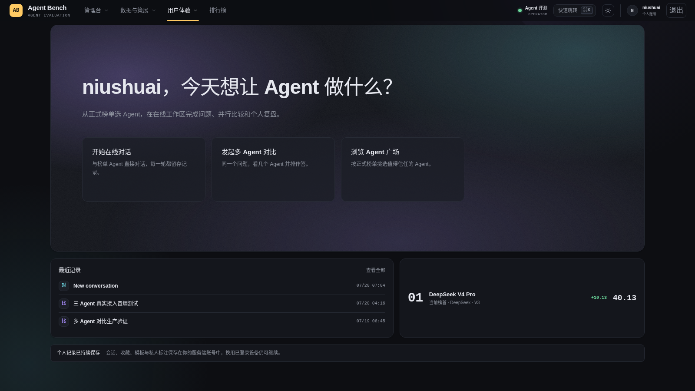
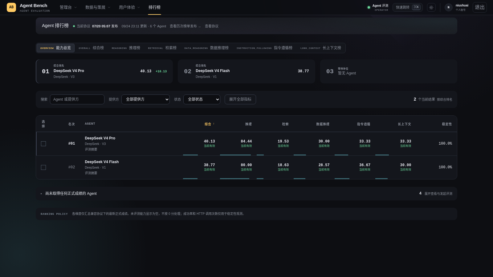
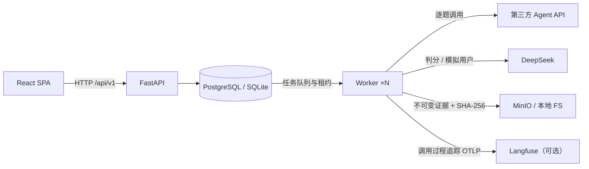

<div align="center">

# Agent Bench

**同一个问题，让它们并排作答。**
**同一套题，让分数自己说话。**

第三方 Agent 评测与运行平台：统一协议评测 · 线上轨迹回流 · 逐题证据链 · 可信排行榜

<p>
  
  
  
  
</p>

[产品截图](#产品截图) · [快速开始](#快速开始) · [能力一览](#能力一览) · [评测协议](#评测协议) · [English](#english) · [生产部署](deploy/runbook.md)

</div>

---

## 产品截图

<p align="center">
  
</p>
<p align="center"><strong>首页</strong>：三个入口——对话、对比、广场。背后是同一条评测流水线。</p>

<p align="center">
  
</p>
<p align="center"><strong>排行榜</strong>：每个分数都能下钻到原始回答、HTTP Attempt、Judge 理由和不可变 Artifact。</p>

## 这是什么

评测一个 Agent 很容易沦为玄学：换个 Prompt 分数就变，换套题排名就翻，跑出来的数字谁也说不清从哪来的。
Agent Bench 把这件事工程化——**接入、体验、评测、证据、发布、运维**串成一条流水线，
让"这个 Agent 好不好"从主观印象变成可审计的数据资产。

它不是一次性跑分脚本。同一份 Prompt、同一套协议、同一条证据链：
你今天跑的分，三个月后还能复现、还能对比、还能拿出证据。

## 快速开始

从零到跑起来只要四步（Docker 一体化、密钥生成、演示数据的完整版见
[`deploy/QUICKSTART.md`](deploy/QUICKSTART.md)）：

```bash
uv sync && pnpm install
uv run alembic upgrade head
uv run uvicorn agent_eval.api.main:app --reload   # API  http://localhost:8000
uv run python -m agent_eval.worker.main           # Worker（评测是异步的，必须单独跑）
pnpm dev:web                                       # Web  http://localhost:5173
```

没有真实 Agent 和 API Key 也能体验全链路——内置假 Agent / 假裁判演示服务：

```bash
uv run python -m agent_eval.maintenance.main seed-fake-agents
uv run python -m agent_eval.maintenance.main queue-fake-run --questions 20
```

> [!IMPORTANT]
> 不要提交 `.env`、真实数据集、数据库、Artifact、备份、登录凭据、Agent Token 或第三方 API Key。
> 公开部署必须使用 HTTPS，且不得将 PostgreSQL 或 MinIO 端口暴露到公网。

## 能力一览

- **Agent 接入，先体检再上岗**。HTTP API、Bearer、请求模板、答案 JSONPath；连接测试、候选版本、预检全通过才允许进评测。
- **在线工作区，流式作答**。持久化多轮会话、重新生成，2–5 个 Agent 对同一 Prompt 并排打字机输出。
- **自带 Key，七家直连**。百炼、DeepSeek、OpenAI、智谱、xAI Grok、Claude、小米 MiMo；AES-GCM 加密落库，接口永不回显。
- **交互任务评测，测办事不测背书**。τ²-bench 三域 278 个客服任务 + MCPMark 40 个文件操作任务；文本协议让哑 HTTP Agent 也能调用工具，状态断言程序化判分。
- **统计上不出假名次**。每题多次运行、pass@1 / pass^k、1000 次 bootstrap 置信区间；认证失败、欠费、配置错误直接判 run 无效。
- **成本摊开来算**。七家 35 个模型内置价格表，总成本、每题成本、输入/输出 Token 占比贯通运行与榜单。
- **分数必须有证据**。单题回答、Judge 理由、HTTP Attempt、Token、引用校验、交互轨迹逐轮回放。
- **质量形成闭环**。版本化 Bad Pattern 规则、失败自动聚类、人工质检、裁判一致性校准（Cohen's kappa）、生产轨迹幂等回流。
- **你的东西只属于你**。收藏、Prompt 模板、点赞点踩、私人笔记、记录历史、Markdown / JSON 导出；私人 Agent 永不上公共榜单。

## 评测协议

题库分两类：**静态答题**（选择/简答/开放题，进总榜）和**交互任务**（多轮对话 + 工具调用，实验档）。
每档冻结数据版本与评分配置，避免不同测试口径制造虚假排名。

### Official V4（默认档）

新题来自独立 `official-v4` cohort，再与已冻结的 BrowseComp / BrowseComp-ZH / FinQA
组合，共 **100 道题**。综合权重：推理 40 / 检索 35 / 数据推理 25。

| 数据集 | 题量 | 维度 | 说明 |
| --- | ---: | --- | --- |
| GPQA Diamond | 20 | 推理 | 研究生级科学题 |
| CMMLU | 20 | 推理 | 中文综合能力，CC BY-NC |
| GSM8K | 20 | 推理 | 小学数学应用题 |
| BrowseComp | 10 | 检索 | 沿用已冻结的 legacy-v1 |
| BrowseComp-ZH | 20 | 检索 | 沿用已冻结的 legacy-v1 |
| FinQA | 10 | 数据推理 | 沿用已冻结的 legacy-v1 |

每科是固定种子抽样，适合平台横向比较，不是完整公开榜复现。不含 HumanEval、LiveCodeBench
或 IFEval。CMMLU 仅限非商业研究，不得再分发。

### Unified V3

仍可选用。由多个冻结数据版本按逻辑组合，不重复复制题目。综合 Profile **175 道题**，
并为每个维度提供协议一致的专项 Profile。全局当前快照仍由 unified-v3 综合跑分切换。

| 维度 | 题目数 | 主要考察内容 |
| --- | ---: | --- |
| 推理 | 45 | 逻辑分析、知识推理与问题求解 |
| 检索 | 35 | 信息查找、来源识别与引用能力 |
| 数据推理 | 35 | 表格、财务与结构化数据分析 |
| 指令遵循 | 30 | 格式约束、规则执行与精确输出 |
| 长上下文 | 30 | 长文本理解、信息定位与跨段整合 |

超时、输入超限和错误答案作为能力证据计 0 分；认证失败、响应结构错误和大规模客户端配置错误
由有效性门禁拦截，不允许错误配置污染正式榜单。

### Held-out V1（防污染档）

公开题库模型可能背过，分数必然虚高——这一档的 100 道题来自模型训练语料之外：
LiveBench（数学/推理/数据分析各 20，半年轮换）+ HLE 纯文本子集（40）。
题目原文在所有界面和 API 一律遮蔽，Worker 内部执行照常。**想看真本事，跑这一档。**

### 交互任务档（τ²-bench / MCPMark，实验档不进总榜）

被测 Agent 与模拟用户多轮对话、调用工具完成任务，最终按数据库状态断言程序化判分：

| Profile | 题量 | 场景 |
| --- | ---: | --- |
| tau2-retail / tau2-telecom / tau2-airline | 114 / 114 / 50 | τ²-bench 客服任务（零售/电信/航司），DeepSeek 扮演用户 |
| mcp-filesystem / mcp-filesystem-standard | 10 / 30 | MCPMark 文件操作任务，真实 MCP server + verify.py 校验 |

哑 HTTP Agent 通过文本协议参与：每轮把工具 Schema + 对话历史渲染成文本，Agent 返回
JSON 动作（回应 / 调工具 / 结束），平台真实执行工具并回写结果。协议失败的 episode 记 0 分，
每个任务的完整轨迹可在证据页逐轮回放。

## 私人 API，默认安全

- **密钥不回显**：API Key 绑定用户与版本，AES-GCM 加密；接口不返回 Key、Endpoint、请求模板或原始响应。
- **租户级隔离**：私人 Agent 只属于创建者，不进公共广场、收藏、评测案例、正式运行、实验或排行榜。
- **受控出网**：只允许七家平台预设，不接受任意 Endpoint，从入口规避 SSRF。
- **健康保护**：401 / 402 / 403 自动停用版本、取消排队任务；恢复后需显式测试才能再启用。
- **候选不打断使用**：更新 Key 或模型会创建不可变候选版本；测通前，旧的健康版本继续服务。

## 技术架构



| 层级 | 技术与职责 |
| --- | --- |
| Web | React、TypeScript、Vite、TanStack Query、ECharts |
| API | Python 3.12、FastAPI、SQLAlchemy、Alembic |
| Worker | 异步推理、τ²/MCP 交互执行、Bad Pattern、Judge、引用抓取、排行榜发布 |
| Data | SQLite 本地开发；PostgreSQL 多 Worker 生产部署 |
| Artifact | 本地文件系统或 S3 / MinIO；索引记录大小、SHA-256 与保留期限 |
| Runtime | Docker Compose、Nginx、数据库租约、全局请求槽、备份与监控 |

## 数据

`data/` 已忽略，构建产物不要入库或外传。BrowseComp 作者要求不得公开解密样本；C-Eval、
BizFinBench、CMMLU 含非商业条款。

<details>
<summary><strong>演示数据集（150 题，最快上手）</strong></summary>

```bash
uv run python -m agent_eval.maintenance.main build-demo-dataset
uv run python -m agent_eval.maintenance.main import-dataset data/demo-dataset --require-demo-distribution
```

```bash
uv run python -m agent_eval.maintenance.main build-official-v4
uv run python -m agent_eval.maintenance.main import-official-v4 data/official-v4
```

六个冻结版本齐备后，API 才会把 `official-v4` 设为默认档。balanced-v2 只能走
`import-balanced-v2`，不要混进 `legacy-v1`。

</details>

<details>
<summary><strong>heldout-v1 防污染题库（LiveBench + HLE）</strong></summary>

LiveBench 公开可拉；HLE 是 gated 数据集，需要先在 HuggingFace 接受条款、用自己的 token
构建，且 HLE 要求不得公开转存数据（canary 需从训练语料过滤）：

```bash
uv run python -m agent_eval.maintenance.main build-livebench
uv run python -m agent_eval.maintenance.main import-livebench data/livebench-heldout
HF_TOKEN=<your-hf-token> uv run python -m agent_eval.maintenance.main build-hle
uv run python -m agent_eval.maintenance.main import-hle data/hle-heldout
```

两部分各 60 / 40 题齐备后 `heldout-v1` profile 才会出现。更新 pin 的 revision 重新构建
导入即可轮换（同 benchmark 自动 version+1，profile 取最新）。

</details>

<details>
<summary><strong>τ²-bench 交互任务（278 题）</strong></summary>

数据不随 wheel 分发，同样不要入库或外传：

```bash
uv sync --group tau2
git clone --depth 1 --branch v1.0.1 https://github.com/sierra-research/tau2-bench.git /tmp/tau2-src
export TAU2_DATA_DIR=/path/to/tau2-data   # 内含 tau2/domains/{retail,telecom,airline}
uv run python -m agent_eval.maintenance.main import-tau2 --domain retail    # 全量 114 题
uv run python -m agent_eval.maintenance.main import-tau2 --domain telecom
uv run python -m agent_eval.maintenance.main import-tau2 --domain airline   # 全量 50 题
```

`import-tau2-retail` 保留为 `--domain retail` 的兼容别名。worker 侧需要 `TAU2_DATA_DIR` 和
`AGENT_EVAL_DEEPSEEK_API_KEY`（用户模拟器固定走 `deepseek/deepseek-chat`，与裁判共享并发槽位）。
`--limit` 子集仅供开发调试：题目数不足全量时对应 profile 不会出现。

</details>

<details>
<summary><strong>MCPMark 文件操作任务（40 题）</strong></summary>

执行时下载初始状态、起 stdio MCP server、verify.py 程序化判分。worker 镜像已内置
Node.js 与预热的 filesystem server：

```bash
uv sync --group mcp
git clone https://github.com/eval-sys/mcpmark /tmp/mcpmark-src   # 建议 pin 到具体 commit
export MCPMARK_REPO_PATH=/path/to/mcpmark   # 内含 tasks/ 与 .mcpmark-commit
uv run python -m agent_eval.maintenance.main import-mcpmark-filesystem --suite easy
uv run python -m agent_eval.maintenance.main import-mcpmark-filesystem --suite standard
```

</details>

## 验证

```bash
uv run ruff check .
uv run mypy
uv run pytest
pnpm lint:web
pnpm test:web
pnpm build:web
pnpm test:e2e    # Playwright 端到端（独立 sqlite + fake services，无需外部 API）
```

每次 push 都会过一遍上面的全部检查（GitHub Actions）。

## 部署

第三方从零部署见 [`deploy/QUICKSTART.md`](deploy/QUICKSTART.md)。最小本地栈：

```bash
docker compose -f deploy/compose.yaml up --build
```

本地栈只绑回环。生产用 [`deploy/manage.sh`](deploy/runbook.md) 和 fail-closed overlay，
不要把基础 Compose 暴露到公网。可信内网 HTTP 可设 `WEB_BIND` / `WEB_PORT`，并加上
`deploy/compose.http-lan.yaml`。`deploy/compose.src-mount.yaml` 会把 API 源码挂进容器，
免重建镜像。两者都不是公网配置。

---

## English

Internal platform for reproducible evaluation, live comparison, evidence inspection, and ranking of
third-party Agent APIs.

**Same prompt. Same protocol. Same evidence chain.** Every published score can be traced to the
original answer, HTTP attempt, judge rationale, citation check, and immutable artifact.

### Capabilities

- Operator-managed Agent integration with connection tests, immutable versions, and preflight gates
- Persistent workspace: multi-turn chat, regeneration, and 2–5 Agent live comparison with streaming
- Bring-your-own-key presets: DashScope, DeepSeek, OpenAI, Zhipu, xAI Grok, Claude, Xiaomi MiMo
- Official V4 default ranking (100 questions), unified-v3 five-ability protocol (175 questions),
  and the contamination-resistant heldout-v1 profile (LiveBench + HLE, prompts masked everywhere)
- Interactive task evaluation: tau2-bench retail/telecom/airline (278 tasks) and MCPMark
  filesystem (40 tasks) with a text protocol that lets plain HTTP agents call tools, scored by
  programmatic state assertions with full trajectory replay
- Statistical rigor: repeated trials per question, pass@1 / pass^k, bootstrap confidence
  intervals, and a validity gate that invalidates runs on auth/billing/config failures
- Cost reporting with built-in pricing for 35 models across 7 providers
- Per-question evidence, Bad Pattern review, LLM-assisted failure clustering, judge calibration
  (Cohen's kappa), and idempotent production-trace ingest
- Private agents stay owner-scoped and never appear on public boards

### Local development

```bash
uv sync
pnpm install
uv run alembic upgrade head
uv run uvicorn agent_eval.api.main:app --reload
uv run python -m agent_eval.worker.main
pnpm dev:web
```

Web: `http://localhost:5173` · API: `http://localhost:8000`

A from-zero third-party deployment guide lives in [`deploy/QUICKSTART.md`](deploy/QUICKSTART.md).
Verification, dataset licenses, production TLS, and backup procedure live in
[`deploy/runbook.md`](deploy/runbook.md) and [`AGENTS.md`](AGENTS.md).

---

<div align="center">

读到这里说明你是认真的 README 读者——这个平台就是为你这种人造的。
证据链已就位，去跑一个 run 吧。

</div>
