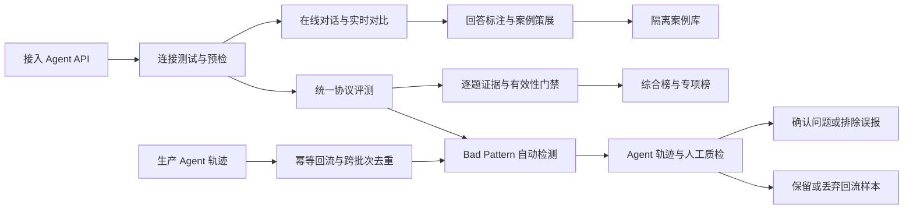

<div align="center">

# Agent Bench

### Agent Evaluation Platform

**把“这个 Agent 好不好”，变成可复现、可追踪、可发布的工程结论。**

统一协议评测 · 线上轨迹回流 · Bad Pattern 检测 · Agent 质检 · 逐题证据链 · 可信排行榜

<p>
  
  
  
  
  
</p>

[产品概览](#产品概览) · [快速开始](#快速开始) · [English Documentation](#english-documentation) · [生产部署](deploy/runbook.md)

</div>

---

## 产品概览

Agent Bench 是一套面向真实第三方 Agent API 的评测与运行平台。它不是一次性跑分脚本，
而是把 **接入、体验、评测、证据、发布和运维** 串成一条完整链路，让模型能力比较从主观印象
升级为可审计的数据资产。

> 同一份 Prompt、同一套协议、同一条证据链。每一个分数都能回到原始回答、HTTP Attempt、
> Judge 理由、引用验证和 Artifact。

### 为什么选择 Agent Bench

<table>
  <tr>
    <td width="25%" valign="top"><strong>真实 API，不是静态样例</strong><br /><sub>直接接入第三方 Agent，记录延迟、Token、错误类型和完整执行状态。</sub></td>
    <td width="25%" valign="top"><strong>同协议横向比较</strong><br /><sub>冻结数据、评分配置与协议版本，避免不同测试口径制造虚假排名。</sub></td>
    <td width="25%" valign="top"><strong>结果有证据可追溯</strong><br /><sub>从榜单分数下钻到单题回答、Judge 解释、引用与不可变 Artifact。</sub></td>
    <td width="25%" valign="top"><strong>评测之外也能直接使用</strong><br /><sub>持久化多轮对话、2-5 Agent 实时对比，以及用户自带 API Key。</sub></td>
  </tr>
</table>

### 从接入到发布



### 能力矩阵

| 场景 | 你可以做什么 |
| --- | --- |
| **Agent 接入** | 配置 HTTP API、Bearer 认证、请求模板、答案与引用 JSONPath；通过连接测试、候选版本和预检后再上线 |
| **在线工作区** | 创建持久化多轮会话、重新生成回答，并让 2-5 个 Agent 对同一原始 Prompt 并行作答 |
| **用户自带 API** | 通过阿里百炼、DeepSeek、OpenAI 固定预设接入私人 Key；常见展示名自动规范化为官方 model ID |
| **评测实验** | 将多个独立运行固化为同协议实验，统一查看进度、能力成绩、名次、失败和运行质量 |
| **质量闭环** | 从完整归档回答中执行有边界的版本化 Bad Pattern 规则，按执行项生成质检任务，支持人员分配、优先级、批量确认/排除、人工结论和已确认 JSONL 回流导出 |
| **线上数据回流** | 按来源批次幂等接收生产、预发或历史回放轨迹，跨批次去重并自动预扫 Bad Pattern；通过游标分页、风险筛选和批量保留/丢弃治理大规模样本 |
| **证据审计** | 按题查看回答、参考答案、评分理由、HTTP Attempt、Token、延迟、引用验证与 Artifact 状态 |
| **可信排行** | 发布综合榜，以及推理、检索、数据推理、指令遵循、长上下文五类专项榜 |
| **用户资产** | 管理 Agent 收藏、Prompt 模板、点赞/点踩、回答收藏、私人笔记、记录历史与 Markdown/JSON 导出 |
| **生产运维** | PostgreSQL 多 Worker、分布式资源租约、S3/MinIO Artifact、自动备份、恢复演练与运行监控 |

### Unified V3 评测协议

`unified-v3` 由多个冻结数据版本按逻辑组合，不重复复制题目。综合 Profile 包含 **175 道不同题目**，
并为每个维度提供协议一致的专项 Profile。

| 维度 | 题目数 | 主要考察内容 |
| --- | ---: | --- |
| 推理 | 45 | 逻辑分析、知识推理与问题求解 |
| 检索 | 35 | 信息查找、来源识别与引用能力 |
| 数据推理 | 35 | 表格、财务与结构化数据分析 |
| 指令遵循 | 30 | 格式约束、规则执行与精确输出 |
| 长上下文 | 30 | 长文本理解、信息定位与跨段整合 |

超时、输入超限和错误答案会作为能力证据计 0 分；认证失败、响应结构错误和大规模客户端配置错误
由独立有效性门禁处理，不允许错误配置污染正式榜单。

### 私人 API，默认安全

- **密钥不回显**：API Key 使用绑定用户与版本的 AES-GCM 认证加密，接口不返回 Key、Endpoint、请求模板或原始提供方响应。
- **租户级隔离**：私人 Agent 仅属于创建者，不进入公共广场、收藏、评测案例、正式运行、评测实验或排行榜。
- **受控出网**：只允许平台维护的提供方预设，不接受任意 Endpoint，从入口规避 SSRF。
- **健康保护**：401、402、403 会自动停用版本、取消排队任务并通知运行中任务停止；恢复后需显式测试才能重新启用。
- **候选不打断使用**：更新 Key 或模型会创建不可变候选版本；测试通过前，旧的健康版本仍可继续服务。
- **旧模型别名兼容**：DeepSeek 已于 2026-07-24 停用 `deepseek-chat` / `deepseek-reasoner`；平台会自动映射到 `deepseek-v4-flash`。

### 技术架构

| 层级 | 技术与职责 |
| --- | --- |
| Web | React、TypeScript、Vite、TanStack Query |
| API | Python 3.12、FastAPI、SQLAlchemy、Alembic |
| Worker | 异步推理、Bad Pattern 检测、Judge 评分、引用抓取、Workspace Attempt 与排行榜发布 |
| Data | SQLite 本地开发；PostgreSQL 多 Worker 生产部署 |
| Artifact | 本地文件系统或 S3/MinIO；索引记录大小、SHA-256 与保留期限 |
| Runtime | Docker Compose、Nginx、数据库租约、全局请求槽、systemd 备份与监控 Timer |

## 快速开始

### 1. 安装依赖

```bash
uv sync
pnpm install
```

### 2. 初始化数据库

```bash
uv run alembic upgrade head
```

### 3. 分别启动 API、Worker 与 Web

```bash
# API
uv run uvicorn agent_eval.api.main:app --reload

# Worker
uv run python -m agent_eval.worker.main

# Web
pnpm dev:web
```

| 服务 | 默认地址 |
| --- | --- |
| Web | `http://localhost:5173` |
| API | `http://localhost:8000` |

首次启动还需要生成登录密码哈希、Agent Token 加密密钥并配置 Judge API Key。完整配置、
PostgreSQL/MinIO 切换、备份、恢复与生产发布流程见 [`deploy/runbook.md`](deploy/runbook.md)。

> [!IMPORTANT]
> 不要提交 `.env`、真实数据集、数据库、Artifact、备份、登录凭据、Agent Token 或第三方 API Key。
> 公开部署必须使用 HTTPS，且不得将 PostgreSQL 或 MinIO 端口暴露到公网。

> [!NOTE]
> 当前本地代码基线：后端 `250 passed, 4 skipped`，前端 `94 passed`；Ruff、mypy、
> ESLint、TypeScript、Vite 生产构建和空库 Alembic 升级均通过。另有 9 个数据集集成
> 用例依赖未提交到仓库的 `data/demo-dataset`，缺少该数据时不会计入上述通过数。

## English Documentation

Internal platform for reproducible evaluation, live comparison, evidence inspection, and ranking of
third-party Agent APIs.

## Key Capabilities

- **Agent integration:** Operator-managed HTTP endpoints, authentication, request templates, answer
  JSONPath mappings, citation mappings, immutable versions, connection tests, and preflight gates.
- **Asynchronous evaluation:** Independent API and Worker processes execute inference, judging,
  citation retrieval, result validation, and leaderboard publication.
- **User workspace:** Persistent multi-turn conversations, regeneration, 2-5 Agent live comparisons,
  personal records, exports, favorites, prompt templates, feedback, bookmarks, and private notes.
- **Bring Your Own Key:** Users can add private DashScope, DeepSeek, or OpenAI credentials through
  server-controlled presets. Common display names are normalized to provider model IDs before use.
- **Evaluation evidence:** Per-question answers, reference answers, judge explanations, HTTP attempts,
  token usage, citation checks, latency samples, and immutable artifacts remain inspectable.
- **Quality operations:** Versioned Bad Pattern rules read archived Agent answers and scan a bounded
  20,000-character window with a per-rule timeout. Findings create per-execution-item review tasks
  with assignees and priorities. Reviewers can batch-confirm or dismiss findings, inspect a unified
  trajectory, attach verdicts and tags, rescan history, and export confirmed feedback as JSONL.
- **Unified and specialist boards:** `unified-v3` publishes comprehensive and ability-specific views
  for reasoning, retrieval, data reasoning, instruction following, and long context.
- **Production operations:** PostgreSQL multi-worker scheduling, distributed resource leases,
  S3/MinIO artifacts, verified backup sets, restore rehearsal, and operational monitoring.

## Private BYOK Agents

Private Agent credentials use owner- and version-bound AES-GCM authenticated encryption. API
responses never return the key, endpoint, request template, authorization header, or raw provider
test response. Arbitrary user-supplied endpoints are intentionally unsupported to avoid SSRF.

A private configuration starts disabled and must pass an explicit connection test before it appears
in chat or live comparison pickers. HTTP 401, 402, or 403 responses automatically mark it unhealthy,
disable further use, cancel queued work, and signal running work to stop. Users can replace a key or
model and test the new immutable candidate while an older healthy version remains available. Each
user may keep up to 10 active private Agent configurations. Retired DeepSeek aliases
`deepseek-chat` and `deepseek-reasoner` (discontinued 2026-07-24) are normalized to
`deepseek-v4-flash`.

Private Agents are owner-scoped and excluded from the public plaza, favorites, curated evaluation
cases, formal runs, evaluation experiments, published snapshots, and leaderboards. Both API routes
and Workers enforce ownership before decrypting a private credential or making a provider request.

## Interaction Safety

Modal dialogs, the Agent directory, leaderboard detail drawers, and the mobile conversation drawer
do not close on backdrop clicks or `Escape`. They close only through explicit in-surface controls
such as close, cancel, or complete actions, or when route navigation unmounts the surface. The Agent
directory is rendered through a document-level portal so workspace overflow cannot clip its header,
filters, or internal scrolling region.

## Prerequisites

- Python 3.12
- uv
- Node.js 24
- pnpm 11
- Docker Compose

## Local Development

Install dependencies:

```bash
uv sync
pnpm install
```

Generate the two shared password hashes and place them in `.env`:

```bash
uv run python -m agent_eval.maintenance.main hash-password
```

Use the generated values for `AGENT_EVAL_READ_ONLY_PASSWORD_HASH` and
`AGENT_EVAL_OPERATOR_PASSWORD_HASH`. Sessions last 7 days for read-only users and 8 hours for
operators. When writing Argon2 hashes to `.env`, wrap each value in single quotes so its `$`
characters are not interpreted by Compose.

Generate the Agent Token encryption key:

```bash
uv run python -m agent_eval.maintenance.main generate-encryption-key
```

Store it as `AGENT_EVAL_ENCRYPTION_KEY`. Losing this key makes saved Bearer Tokens impossible to
decrypt.

Create or rotate a named workspace user without placing plaintext credentials in command-line
arguments. Omitting `--credential-output` prompts securely; when it is present, the command creates
the output file with mode `0600` and refuses to replace an existing path:

```bash
uv run python -m agent_eval.maintenance.main create-workspace-user \
  alice "Alice Example" read_only --credential-output /secure/alice.credential
uv run python -m agent_eval.maintenance.main reset-workspace-user-password \
  alice --credential-output /secure/alice-reset.credential
```

Run the API:

```bash
uv run alembic upgrade head
uv run uvicorn agent_eval.api.main:app --reload
```

Run the Worker in another terminal:

```bash
uv run python -m agent_eval.worker.main
```

On PostgreSQL, the configured Agent, judge, citation-fetch, and citation-domain concurrency values
are deployment-wide across all API and worker replicas. SQLite keeps process-local limits. Request
leases heartbeat during long calls and expired leases make crashed holders reclaimable; see
`deploy/runbook.md` for lease timing and database-pool sizing.

The worker also claims durable workspace attempts. Multi-turn chat calls receive a deterministic,
role-labeled conversation through the configured `{{prompt}}` placeholder; parallel comparisons
send the exact same unwrapped prompt to every selected Agent. Successful answers can be snapshotted
as curated evaluation cases without creating formal questions, runs, snapshots, or leaderboard
results. `AGENT_EVAL_WORKER_MAX_LOCAL_WORKSPACE_ATTEMPTS` defaults to `2` per worker; Agent-version
request slots remain deployment-wide on PostgreSQL. A stale running workspace attempt is canceled
when cancellation was already requested, otherwise it fails as `worker_lost`; neither state is
automatically sent to the provider again.
If a pinned version is retired, the conversation must be explicitly repinned to an active version
of the same logical Agent while no generation is active; existing turns remain unchanged and feed
future transcripts. Cross-table message role/conversation equality cannot be expressed as a
portable SQLite/PostgreSQL check constraint, so workers validate it both before provider execution
and before successful finalization.

Artifact storage is selected with `AGENT_EVAL_ARTIFACT_BACKEND`; `local` remains the default.
`AGENT_EVAL_ARTIFACT_LOCAL_DIR` defaults to `<AGENT_EVAL_DATA_DIR>/artifacts`. The `s3` backend uses
`AGENT_EVAL_ARTIFACT_S3_BUCKET` plus optional `PREFIX`, `ENDPOINT_URL`, `REGION`, and
`FORCE_PATH_STYLE` settings. Credentials come only from boto3's standard AWS credential chain, such
as environment variables, container credentials, or instance roles. Stored database keys remain
relative POSIX paths; the configured S3 prefix is applied internally and does not change
`artifact_index.relative_path`.

Production PostgreSQL plus S3/MinIO backups are created with `deploy/backup-production.sh`. The
workflow writes a verified custom-format PostgreSQL dump and a verified indexed artifact archive,
then atomically publishes a backup-set manifest as its completion marker. Configure
`AGENT_EVAL_BACKUP_PATH` and see `deploy/runbook.md` for scheduling, retention, consistency, and
isolated restore rehearsal procedures. A local backup directory protects against logical failures,
not host loss; replicate complete sets to independent off-host storage.

Run the Web app:

```bash
pnpm dev:web
```

The Vite server is available at `http://localhost:5173` and proxies API calls to `http://localhost:8000`.

## Demo Dataset

Build the fixed 100-question demo dataset from pinned official sources, then import it:

```bash
uv run python -m agent_eval.maintenance.main build-demo-dataset
uv run alembic upgrade head
uv run python -m agent_eval.maintenance.main import-dataset data/demo-dataset --require-demo-distribution
```

The build contains C-Eval 30, MMLU-Pro 10, BrowseComp-ZH 20, BrowseComp 10,
BizFinBench 20, and FinQA 10. It enforces 70 Chinese and 30 English questions, the three
ability totals, and all three scoring question types. Source revisions, sampling seed, and file
hashes are recorded in `data/demo-dataset/manifest.json`.

`data/demo-dataset/` is intentionally ignored. BrowseComp's authors request that decrypted
examples not be published because doing so leaks the benchmark. Review each dataset's license
note before any commercial or public use; C-Eval and BizFinBench include noncommercial terms.

Running the import command again reuses versions with identical canonical content hashes. A
changed question set creates the next frozen version instead of mutating prior data.

Audit a source bundle before importing it. The `balanced-v2` policy targets five dimensions with
30 questions each, balanced equally across Chinese and English and using canonical
`easy`/`medium`/`hard` difficulty labels:

```bash
uv run python -m agent_eval.maintenance.main audit-dataset data/demo-dataset \
  --policy balanced-v2
```

Add `--enforce` in CI when the bundle is expected to satisfy the policy. Audit output is stable
JSON and includes logical content hashes, cross-dimension distributions, metadata coverage,
prompt-length buckets, and machine-readable violations.

Build the local-only 150-question candidate cohort from reviewed anchors and deterministic
original tasks:

```bash
uv run python -m agent_eval.maintenance.main build-balanced-v2
uv run python -m agent_eval.maintenance.main audit-dataset data/balanced-v2-candidate \
  --policy balanced-v2 --enforce
uv run python -m agent_eval.maintenance.main import-balanced-v2 data/balanced-v2-candidate
```

The candidate output is intentionally ignored because it includes restricted benchmark anchors.
Its manifest records source decisions, redistribution restrictions, deterministic answer checks,
and the canonical bundle hash. Generic imports remain restricted to released abilities in the
`legacy-v1` cohort. `import-balanced-v2` is the only candidate import path: it reruns the enforced
150-question audit, stores the isolated `balanced-v2` cohort, and creates or reuses the
20/20/20/20/20 score configuration. Deployment and bootstrap do not run this import automatically.

### Unified V3 Profiles

Once both frozen cohorts are complete, the API exposes `unified-v3` as the default ranking profile.
It is an immutable composition, not another dataset import: all 6 latest frozen `legacy-v1`
versions (100 questions) are combined with only the 7 language-specific dataset versions from the
5 balanced-v2 original benchmark families (75 questions). The 75 balanced anchors are not selected again, so the profile contains 175
distinct prompts: reasoning 45, retrieval 35, data reasoning 35, instruction following 30, and
long context 30.

The comprehensive profile and `unified-v3-<ability>` specialist profiles all use the
20/20/20/20/20 score configuration and the `unified-v3` protocol epoch. A comprehensive ability
result and its corresponding specialist result therefore share a metric protocol hash, while run
protocol hashes remain profile-specific. Legacy and balanced profiles remain available for
archival runs, but global leaderboards and run-status summaries only use ranking runs from the
unified-v3 profile family. Historical snapshots remain available through leaderboard history.

At cutover, archive any pre-unified current snapshot without deleting it:

```bash
uv run python -m agent_eval.maintenance.main archive-current-leaderboard
```

The command is idempotent. The next published `unified-v3` comprehensive run becomes current.
Ability scores are question-weighted means; benchmark-level breakdowns remain available.

Ranking publication validates each Agent result before it can enter a global leaderboard.
Authentication failures always invalidate a result, as do response-schema and client-configuration
failures affecting at least 20% of execution items. Timeouts, input limits, and other capability
failures remain valid zero-score evidence. Revalidate existing unified-v3 results after upgrading:

```bash
uv run python -m agent_eval.maintenance.main revalidate-ranking-results
```

The repair is idempotent, preserves snapshots, removes invalid global result rows, and selects the
newest comprehensive snapshot that still contains a valid result when current state needs repair.

Agent responses may report OpenAI-style `prompt_tokens`/`completion_tokens` or DashScope-style
`input_tokens`/`output_tokens` under `usage`. Valid nonnegative counts are persisted per HTTP
attempt and summed in published run and global leaderboard metrics; historical or malformed usage
remains unknown rather than being estimated. `token_usage_available_count` counts attempts with a
complete input/output/total tuple, while `token_usage_missing_count` counts terminal attempts with
partial or absent usage. Published latency p50 and p95 values use the deterministic nearest-rank
method over terminal attempts that have a latency sample. Monetary cost is not estimated.

For citation-required questions, configured citation JSONPath values remain preferred. If that
mapping yields no valid URLs, up to three distinct HTTP/HTTPS URLs embedded in the extracted answer
are used as a fallback. Ordinary answer text is never treated as a citation.

## Verification

Current release baseline: backend `253 passed, 3 skipped`; frontend `90 passed`. Ruff, mypy, ESLint,
TypeScript, and the Vite production build pass.

```bash
uv run ruff check .
uv run mypy
uv run pytest
pnpm lint:web
pnpm test:web
pnpm build:web
```

## Docker Compose

```bash
docker compose -f deploy/compose.yaml up --build
```

An optional private MinIO overlay is available for S3-compatible deployments. It is not part of the
base development stack; the current local-real production composition enables it without publishing
MinIO ports:

```bash
cp .env.minio.example .env.minio
# Replace all credential placeholders first.
docker compose --env-file .env.minio \
  -f deploy/compose.yaml -f deploy/compose.minio.yaml up --build
```

Open `http://localhost:8080`. Run the maintenance check with:

```bash
docker compose -f deploy/compose.yaml --profile tools run --rm maintenance
```

Bootstrap the fixed dataset and default judge/score configuration with:

```bash
docker compose -f deploy/compose.yaml --profile tools run --build --rm maintenance bootstrap --dataset /datasets/demo
```

The base Compose file is for local development and binds plain HTTP. Production uses the separate
fail-closed overlay, read-only Secret files, a host data path, resource/log limits, and loopback-only
Web binding. See `deploy/runbook.md` and use `deploy/manage.sh`; do not expose the base Compose stack
to the Internet or commit `.env`, dataset contents, passwords, Agent Tokens, or API keys.
