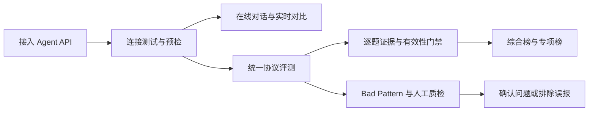

<div align="center">

# Agent Bench

### Agent Evaluation Platform

**把“这个 Agent 好不好”，变成可复现、可追踪、可发布的工程结论。**

统一协议评测 · 线上轨迹回流 · Bad Pattern 检测 · Agent 质检 · 逐题证据链 · 可信排行榜

<p>
  
  
  
  
</p>

[产品概览](#产品概览) · [评测协议](#评测协议) · [快速开始](#快速开始) · [English](#english) · [生产部署](deploy/runbook.md)

</div>

---

## 产品概览

Agent Bench 是一套面向真实第三方 Agent API 的评测与运行平台。它不是一次性跑分脚本，
而是把 **接入、体验、评测、证据、发布和运维** 串成一条完整链路，让模型能力比较从主观印象
升级为可审计的数据资产。

> 同一份 Prompt、同一套协议、同一条证据链。每一个分数都能回到原始回答、HTTP Attempt、
> Judge 理由、引用验证和 Artifact。

### 为什么选择 Agent Bench

<table>
  <tr>
    <td width="25%" valign="top"><strong>真实 API，不是静态样例</strong><br /><sub>直接接入第三方 Agent，记录延迟、Token、错误类型和完整执行状态。</sub></td>
    <td width="25%" valign="top"><strong>同协议横向比较</strong><br /><sub>冻结数据、评分配置与协议版本，避免不同测试口径制造虚假排名。</sub></td>
    <td width="25%" valign="top"><strong>结果有证据可追溯</strong><br /><sub>从榜单分数下钻到单题回答、Judge 解释、引用与不可变 Artifact。</sub></td>
    <td width="25%" valign="top"><strong>评测之外也能直接使用</strong><br /><sub>持久化多轮对话、2-5 Agent 实时对比，以及七家提供方的自带 API Key。</sub></td>
  </tr>
</table>

### 从接入到发布



### 能力一览

| 场景 | 你可以做什么 |
| --- | --- |
| **Agent 接入** | HTTP API、Bearer、请求模板、答案与引用 JSONPath；连接测试、候选版本和预检通过后再上线 |
| **在线工作区** | 持久化多轮会话、重新生成，2–5 个 Agent 对同一 Prompt 并行作答 |
| **用户自带 API** | 百炼、DeepSeek、OpenAI、智谱、xAI Grok、Claude、小米 MiMo；展示名自动规范化为官方 model ID |
| **评测实验** | 多个独立运行固化为同协议实验，统一看进度、能力分、名次、失败和质量 |
| **质量与回流** | 版本化 Bad Pattern 规则、人工质检、生产轨迹幂等回流与跨批次去重 |
| **证据与排行** | 单题回答、Judge 理由、HTTP Attempt、Token、引用校验；默认 Official V4，保留 unified-v3 五维专项 |
| **用户资产** | 收藏、Prompt 模板、点赞点踩、私人笔记、记录历史、Markdown / JSON 导出 |

## 评测协议

### Official V4

当前默认档。新题来自独立 `official-v4` cohort，再与已冻结的 BrowseComp / BrowseComp-ZH / FinQA
组合，共 **100 道题**。综合权重：推理 40 / 检索 35 / 数据推理 25。

| 数据集 | 题量 | 维度 | 说明 |
| --- | ---: | --- | --- |
| GPQA Diamond | 20 | 推理 | 研究生级科学题 |
| CMMLU | 20 | 推理 | 中文综合能力，CC BY-NC |
| GSM8K | 20 | 推理 | 小学数学应用题 |
| BrowseComp | 10 | 检索 | 沿用已冻结的 legacy-v1 |
| BrowseComp-ZH | 20 | 检索 | 沿用已冻结的 legacy-v1 |
| FinQA | 10 | 数据推理 | 沿用已冻结的 legacy-v1 |

每科是固定种子抽样，适合平台横向比较，不是完整公开榜复现。不含 HumanEval、LiveCodeBench
或 IFEval。CMMLU 仅限非商业研究，不得再分发。

### Unified V3

仍可选用。由多个冻结数据版本按逻辑组合，不重复复制题目。综合 Profile **175 道题**，
并为每个维度提供协议一致的专项 Profile。全局当前快照仍由 unified-v3 综合跑分切换。

| 维度 | 题目数 | 主要考察内容 |
| --- | ---: | --- |
| 推理 | 45 | 逻辑分析、知识推理与问题求解 |
| 检索 | 35 | 信息查找、来源识别与引用能力 |
| 数据推理 | 35 | 表格、财务与结构化数据分析 |
| 指令遵循 | 30 | 格式约束、规则执行与精确输出 |
| 长上下文 | 30 | 长文本理解、信息定位与跨段整合 |

超时、输入超限和错误答案作为能力证据计 0 分；认证失败、响应结构错误和大规模客户端配置错误
由有效性门禁拦截，不允许错误配置污染正式榜单。

## 私人 API，默认安全

- **密钥不回显**：API Key 绑定用户与版本，AES-GCM 加密；接口不返回 Key、Endpoint、请求模板或原始响应。
- **租户级隔离**：私人 Agent 只属于创建者，不进公共广场、收藏、评测案例、正式运行、实验或排行榜。
- **受控出网**：只允许七家平台预设，不接受任意 Endpoint，从入口规避 SSRF。
- **健康保护**：401 / 402 / 403 自动停用版本、取消排队任务；恢复后需显式测试才能再启用。
- **候选不打断使用**：更新 Key 或模型会创建不可变候选版本；测通前，旧的健康版本继续服务。

## 技术架构

| 层级 | 技术与职责 |
| --- | --- |
| Web | React、TypeScript、Vite、TanStack Query |
| API | Python 3.12、FastAPI、SQLAlchemy、Alembic |
| Worker | 异步推理、Bad Pattern、Judge、引用抓取、Workspace Attempt、排行榜发布 |
| Data | SQLite 本地开发；PostgreSQL 多 Worker 生产部署 |
| Artifact | 本地文件系统或 S3 / MinIO；索引记录大小、SHA-256 与保留期限 |
| Runtime | Docker Compose、Nginx、数据库租约、全局请求槽、备份与监控 |

## 快速开始

需要 Python 3.12、`uv`、Node 24、pnpm 11。

### 1. 安装依赖

```bash
uv sync
pnpm install
```

### 2. 初始化数据库

```bash
uv run alembic upgrade head
```

### 3. 分别启动 API、Worker 与 Web

```bash
uv run uvicorn agent_eval.api.main:app --reload
uv run python -m agent_eval.worker.main
pnpm dev:web
```

| 服务 | 地址 |
| --- | --- |
| Web | `http://localhost:5173` |
| API | `http://localhost:8000` |

首次启动需生成登录密码哈希、`AGENT_EVAL_ENCRYPTION_KEY` 并配置 Judge API Key。完整配置、
备份、恢复与生产发布见 [`deploy/runbook.md`](deploy/runbook.md)。

> [!IMPORTANT]
> 不要提交 `.env`、真实数据集、数据库、Artifact、备份、登录凭据、Agent Token 或第三方 API Key。
> 公开部署必须使用 HTTPS，且不得将 PostgreSQL 或 MinIO 端口暴露到公网。

## 数据

`data/` 已忽略。构建产物不要入库或外传。BrowseComp 作者要求不得公开解密样本；C-Eval、
BizFinBench、CMMLU 含非商业条款。

```bash
uv run python -m agent_eval.maintenance.main build-demo-dataset
uv run python -m agent_eval.maintenance.main import-dataset data/demo-dataset --require-demo-distribution
```

```bash
uv run python -m agent_eval.maintenance.main build-official-v4
uv run python -m agent_eval.maintenance.main import-official-v4 data/official-v4
```

六个冻结版本齐备后，API 才会把 `official-v4` 设为默认档。balanced-v2 只能走
`import-balanced-v2`，不要混进 `legacy-v1`。

tau2-bench 交互评测（`tau2-retail` profile，retail base split 全量 114 题）使用独立的
依赖组和数据目录；数据不随 wheel 分发，同样不要入库或外传：

```bash
uv sync --group tau2
git clone --depth 1 --branch v1.0.1 https://github.com/sierra-research/tau2-bench.git /tmp/tau2-src
export TAU2_DATA_DIR=/path/to/tau2-data   # 内含 tau2/domains/retail 等目录
uv run python -m agent_eval.maintenance.main import-tau2-retail            # 全量 114 题
uv run python -m agent_eval.maintenance.main import-tau2-retail --limit 5  # 冒烟子集
```

worker 侧需要 `TAU2_DATA_DIR` 和 `AGENT_EVAL_DEEPSEEK_API_KEY`（用户模拟器固定走
`deepseek/deepseek-chat`，与裁判共享 `AGENT_EVAL_DEEPSEEK_CONCURRENCY` 并发槽位）；
`AGENT_EVAL_INTERACTIVE_CONCURRENCY` 与 `AGENT_EVAL_INTERACTIVE_TIMEOUT_SECONDS` 控制单题
并发与超时。`--limit` 子集仅供开发调试：题目数不足 114 时 `tau2-retail` profile 不会出现。

## 验证

```bash
uv run ruff check .
uv run mypy
uv run pytest
pnpm lint:web
pnpm test:web
pnpm build:web
```

## 部署

```bash
docker compose -f deploy/compose.yaml up --build
```

本地栈只绑回环。生产用 [`deploy/manage.sh`](deploy/runbook.md) 和 fail-closed overlay，
不要把基础 Compose 暴露到公网。

可信内网 HTTP 可设 `WEB_BIND` / `WEB_PORT`，并加上 `deploy/compose.http-lan.yaml`。
`deploy/compose.src-mount.yaml` 会把 API 源码挂进容器，免重建镜像。两者都不是公网配置。

---

## English

Internal platform for reproducible evaluation, live comparison, evidence inspection, and ranking of
third-party Agent APIs.

**Same prompt. Same protocol. Same evidence chain.** Every published score can be traced to the
original answer, HTTP attempt, judge rationale, citation check, and immutable artifact.

### Capabilities

- Operator-managed Agent integration with connection tests, immutable versions, and preflight gates
- Persistent workspace: multi-turn chat, regeneration, and 2–5 Agent live comparison
- Bring-your-own-key presets: DashScope, DeepSeek, OpenAI, Zhipu, xAI Grok, Claude, Xiaomi MiMo
- Official V4 default ranking (100 questions) plus unified-v3 five-ability protocol (175 questions)
- Per-question evidence, Bad Pattern review, and idempotent production-trace ingest
- Private agents stay owner-scoped and never appear on public boards

### Official V4

Default ranking profile. Frozen GPQA Diamond 20, CMMLU 20, GSM8K 20, plus legacy BrowseComp 10,
BrowseComp-ZH 20, and FinQA 10. Weights: reasoning 40 / retrieval 35 / data reasoning 25.
Sampled with a fixed seed for platform comparison — not a full public-leaderboard reproduction.
CMMLU is CC BY-NC.

`unified-v3` remains available and still owns the global current snapshot.

### Local development

```bash
uv sync
pnpm install
uv run alembic upgrade head
uv run uvicorn agent_eval.api.main:app --reload
uv run python -m agent_eval.worker.main
pnpm dev:web
```

Web: `http://localhost:5173` · API: `http://localhost:8000`

Verification, dataset licenses, production TLS, and backup procedure live in
[`deploy/runbook.md`](deploy/runbook.md) and [`AGENTS.md`](AGENTS.md).
