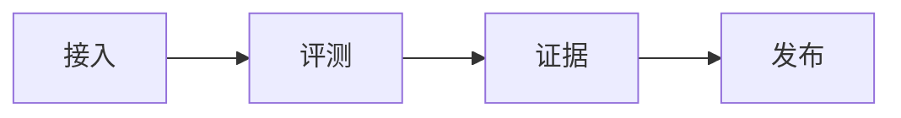

<div align="center">

# Agent Bench

**同一协议、同一证据链，把 Agent 能力变成可发布的结论。**

Reproducible evaluation for live third-party Agent APIs.

<p>
  
  
  
</p>

[评测协议](#评测协议) · [快速开始](#快速开始) · [数据](#数据) · [部署](#部署) · [English](#english)

</div>

---

## 它做什么

面向真实第三方 Agent API，而不是静态样例。接入、对话、评测、证据和发布走同一条链路。

**同协议比较**  
冻结题库、评分配置和协议版本。换模型，不换口径。

**分数能回到原题**  
从综合分下钻到单题回答、Judge 理由、HTTP Attempt、引用校验和不可变 Artifact。

**评测之外也能用**  
多轮对话、2–5 Agent 实时对比，以及七家提供方的自带 Key。



## 评测协议

默认档是 **Official V4**，100 题，权重 推理 40 / 检索 35 / 数据推理 25。每科固定种子抽样，适合平台横向比较，不是完整公开榜复现。

| 数据集 | 题量 | 维度 |
| --- | ---: | --- |
| GPQA Diamond | 20 | 推理 |
| CMMLU | 20 | 推理 |
| GSM8K | 20 | 推理 |
| BrowseComp | 10 | 检索 |
| BrowseComp-ZH | 20 | 检索 |
| FinQA | 10 | 数据推理 |

不含 HumanEval、LiveCodeBench、IFEval。CMMLU 为 CC BY-NC，不得再分发。

`unified-v3` 仍可选用：175 题，覆盖推理、检索、数据推理、指令遵循、长上下文。全局当前快照仍由 unified-v3 综合跑分切换。超时和错答计 0 分；认证失败与大规模配置错误由有效性门禁拦截，不进正式榜。

## 接入与安全

- 只允许七家预设：百炼、DeepSeek、OpenAI、智谱、xAI Grok、Claude、小米 MiMo。不接受任意 Endpoint。
- API Key 按用户与版本 AES-GCM 加密，接口不回显密钥、地址或原始响应。
- 私人 Agent 只属于创建者，不进广场、评测实验或排行榜。
- 401 / 402 / 403 自动停用该版本；换 Key 会生成候选版本，测通前旧版本继续服务。

## 快速开始

需要 Python 3.12、`uv`、Node 24、pnpm 11。

```bash
uv sync
pnpm install
uv run alembic upgrade head
```

```bash
uv run uvicorn agent_eval.api.main:app --reload
uv run python -m agent_eval.worker.main
pnpm dev:web
```

| 服务 | 地址 |
| --- | --- |
| Web | http://localhost:5173 |
| API | http://localhost:8000 |

首次启动需写入密码哈希、`AGENT_EVAL_ENCRYPTION_KEY` 和 Judge Key。生成命令与生产流程见 [`deploy/runbook.md`](deploy/runbook.md)。不要提交 `.env`、题库、备份或任何密钥。

## 数据

`data/` 已忽略。构建产物不要入库或外传。

```bash
uv run python -m agent_eval.maintenance.main build-demo-dataset
uv run python -m agent_eval.maintenance.main import-dataset data/demo-dataset --require-demo-distribution
```

```bash
uv run python -m agent_eval.maintenance.main build-official-v4
uv run python -m agent_eval.maintenance.main import-official-v4 data/official-v4
```

六个冻结版本齐备后，API 才会把 `official-v4` 设为默认档。balanced-v2 只能走 `import-balanced-v2`，不要混进 `legacy-v1`。

## 验证

```bash
uv run ruff check .
uv run mypy
uv run pytest
pnpm lint:web
pnpm test:web
pnpm build:web
```

## 部署

```bash
docker compose -f deploy/compose.yaml up --build
```

本地栈只绑回环。生产用 [`deploy/manage.sh`](deploy/runbook.md) 和 fail-closed overlay，不要把基础 Compose 暴露到公网。

可信内网 HTTP 可设 `WEB_BIND` / `WEB_PORT`，并加上 `deploy/compose.http-lan.yaml`。`deploy/compose.src-mount.yaml` 会把 API 源码挂进容器，免重建镜像。两者都不是公网配置。

---

## English

Internal platform for reproducible evaluation of live Agent APIs. Scores stay bound to a frozen protocol and can be traced to the original answer, judge rationale, HTTP attempt, and artifact.

**Official V4** is the default ranking profile: 100 questions (GPQA Diamond, CMMLU, GSM8K, BrowseComp, BrowseComp-ZH, FinQA) with 40 / 35 / 25 weights for reasoning, retrieval, and data reasoning. **unified-v3** remains the 175-question five-ability protocol and still owns the global current snapshot.

Private BYOK agents accept only seven maintained presets. Credentials never leave the server in API responses, and private agents never appear on public boards.

```bash
uv sync && pnpm install && uv run alembic upgrade head
uv run uvicorn agent_eval.api.main:app --reload
uv run python -m agent_eval.worker.main
pnpm dev:web
```

Full verification, dataset licenses, production TLS, and backup procedure live in [`deploy/runbook.md`](deploy/runbook.md) and [`AGENTS.md`](AGENTS.md).
