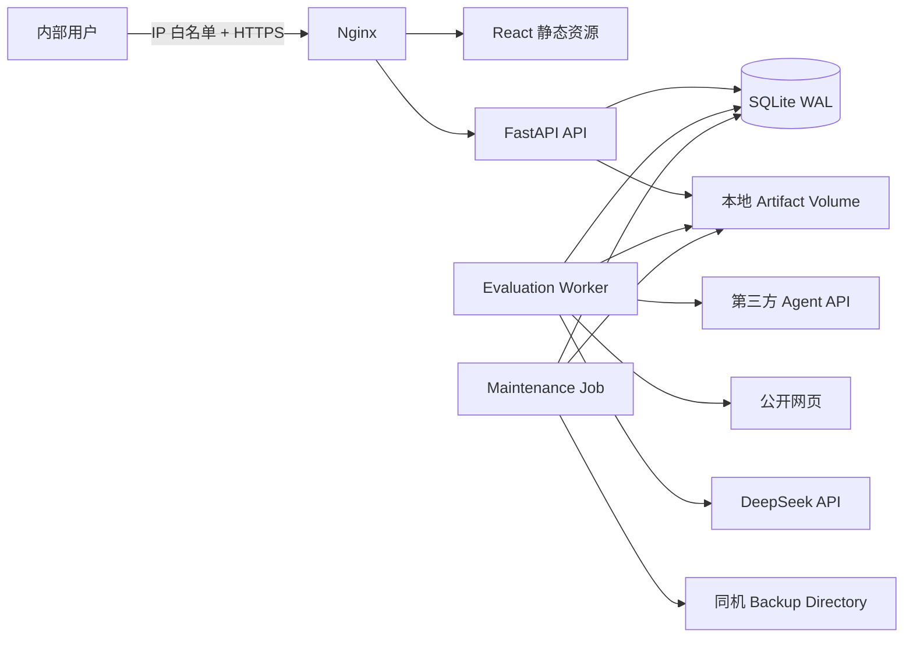
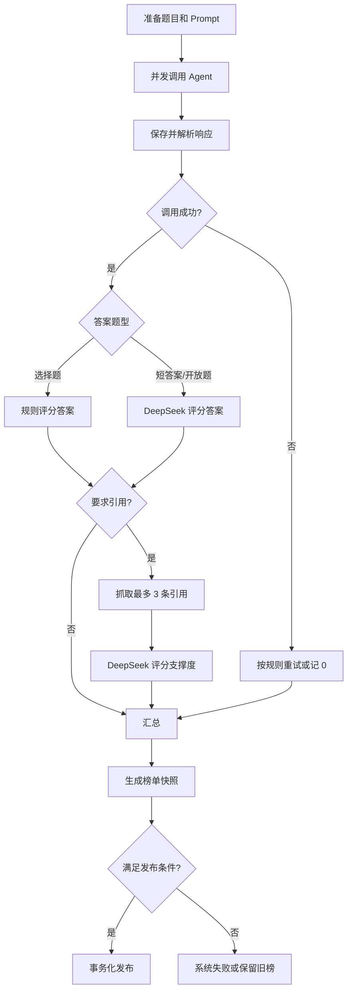

# Agent 评测平台技术架构方案

## 1. 文档信息

| 项目 | 内容 |
|---|---|
| 文档版本 | V0.1 |
| 对应 PRD | `agent-evaluation-platform-prd.md` V0.1 |
| 架构阶段 | 2 至 4 周内部原型 |
| 部署形态 | 中国大陆单台云主机 + Docker Compose |
| 前端 | React + TypeScript，不使用 UI 组件库 |
| 后端 | Python + FastAPI |
| 数据库 | SQLite |
| 任务队列 | SQLite 持久化任务表，不使用 Redis |
| 裁判模型 | DeepSeek `deepseek-v4-flash` |
| 原始内容 | 云主机本地 Docker Volume |

## 2. 架构目标

- 在单机、少组件前提下支撑 5 个 Agent、900 题、单批次当天完成。
- 长任务状态持久化，API 或 Worker 重启后可以恢复。
- 避免 SQLite 在并发网络任务下出现大量写锁冲突。
- Agent 接口、题库、裁判和评分规则均可版本化和追溯。
- 将 Agent 调用、网页抓取、LLM 裁判等不可信外部交互隔离在 Worker。
- 保持从 SQLite 迁移到 PostgreSQL、从单 Worker 迁移到分布式队列的清晰路径。

## 3. 已确认约束

| 决策 | 结果 | 架构影响 |
|---|---|---|
| 首期只运行一个评测任务 | 是 | 不需要分布式调度器 |
| 每个 Agent 默认 5 路并发 | 是 | 单 Worker 内使用异步并发控制 |
| 数据库只使用 SQLite | 是 | 必须使用 WAL、短事务和单写入通道 |
| 不使用 Redis | 是 | 任务队列、租约和心跳保存在 SQLite |
| 原始大文本放本地文件卷 | 是 | SQLite 只保存索引、摘要和文件引用 |
| 固定 DeepSeek 裁判 | 是 | 首期实现单一 DeepSeek 客户端 |
| 不使用前端组件库 | 是 | 建设少量项目内基础组件和设计变量 |
| 大陆云主机无境外代理 | 是 | 境外引用不可达时按引用失败记 0 |
| 备份保存到同机目录 | 是 | 只能防逻辑损坏，不能防主机或磁盘损坏 |

## 4. 总体架构



### 4.1 组件职责

| 组件 | 职责 |
|---|---|
| Nginx | TLS 终止、静态资源、API 反向代理、请求大小限制和基础限速 |
| React Web | 排行榜、Agent 配置、评测向导、运行监控和横向对比 |
| FastAPI API | 访问控制、配置 CRUD、任务命令、榜单查询和文件授权读取 |
| Evaluation Worker | 任务调度、Agent 调用、引用抓取、DeepSeek 评分、汇总与发布 |
| SQLite | 权威业务状态、任务状态、评分结果、榜单快照和 Session |
| Artifact Volume | 原始响应、抓取正文和裁判原始结果等 30 天数据 |
| Maintenance Job | 数据清理、SQLite 一致性检查和每日最新备份 |

## 5. 部署拓扑

### 5.1 Docker Compose 服务

```text
nginx
web
api
worker
maintenance
```

- `web` 只负责构建 React 静态资源，生产运行时可由 Nginx 直接提供构建产物。
- `api` 和 `worker` 使用同一个 Python 镜像和代码版本，通过不同启动命令运行。
- `maintenance` 使用同一个 Python 镜像，按计划执行清理和备份命令。
- `api` 与 `worker` 共享 SQLite 和 Artifact Volume。
- SQLite 文件必须位于云主机本地 ext4/xfs 文件系统，不得位于 NFS、对象存储挂载或多主机共享盘。

### 5.2 推荐云主机规格

| 资源 | 原型建议 |
|---|---|
| CPU | 4 vCPU |
| 内存 | 8 GB |
| 系统盘 | 40 GB |
| 数据盘 | 100 GB SSD 起 |
| 操作系统 | 近期 LTS Linux |
| 网络 | 固定公网 IP，公司出口 IP/VPN 白名单 |

外部 Agent 和 DeepSeek 承担主要推理计算，云主机资源主要用于网络并发、正文抽取、JSON 处理和页面服务。

## 6. 代码仓库结构

建议使用单仓库：

```text
agent-evaluation-platform/
├── apps/
│   ├── api/                  # FastAPI API 和领域服务
│   ├── worker/               # 评测调度与执行入口
│   └── web/                  # React + TypeScript
├── packages/
│   ├── contracts/            # OpenAPI 生成的 TS 类型或共享 Schema
│   └── benchmark-loaders/    # Benchmark 导入适配器
├── migrations/               # SQLite/Alembic 迁移
├── deploy/
│   ├── nginx/
│   └── compose.yaml
├── scripts/                  # 初始化、备份、恢复和数据导入命令
├── tests/
│   ├── integration/
│   └── fixtures/
├── data/                     # 开发环境数据，不提交密钥和生产数据
├── pyproject.toml
└── package.json
```

后端建议使用 `uv` 管理 Python 依赖，前端建议使用 `pnpm`。生产镜像必须锁定依赖版本。

## 7. 后端技术栈

| 能力 | 建议实现 |
|---|---|
| Web API | FastAPI + Uvicorn |
| 配置与校验 | Pydantic Settings |
| ORM | SQLAlchemy 2.x |
| SQLite 异步驱动 | aiosqlite |
| 数据迁移 | Alembic |
| HTTP 客户端 | httpx AsyncClient |
| JSONPath | jsonpath-ng |
| 正文提取 | trafilatura，输入必须来自安全抓取器 |
| 密钥加密 | cryptography AES-GCM |
| 密码哈希 | Argon2id |
| 测试 | pytest + pytest-asyncio |
| 代码质量 | Ruff + mypy |

不允许运营配置或执行 Python/JavaScript 转换脚本。请求模板只做受限变量替换，响应只使用 JSONPath 提取。

## 8. 前端技术栈

| 能力 | 建议实现 |
|---|---|
| 框架 | React + TypeScript + Vite |
| 路由 | React Router |
| 请求与缓存 | TanStack Query |
| 表单 | React Hook Form + Zod |
| 图表 | Apache ECharts，仅封装雷达图和必要统计图 |
| 样式 | CSS Modules + CSS Custom Properties |
| 测试 | Vitest + React Testing Library + Playwright |

### 8.1 不使用 UI 组件库的控制措施

首期只实现以下项目内基础组件：

- Button。
- Input、Textarea、Select。
- FormField 和错误提示。
- Table。
- Tabs。
- Modal。
- Stepper。
- Badge。
- Progress。
- Toast。
- EmptyState 和 ErrorState。

使用统一的颜色、间距、圆角、字体和状态变量，不建设通用设计系统网站。桌面端最小设计宽度建议为 1280px。

### 8.2 状态更新

- 运行中任务使用 HTTP 轮询，不引入 WebSocket 或 SSE。
- 任务详情页运行时每 3 秒轮询一次。
- 页面不可见时降为每 15 秒轮询一次。
- 任务进入终态后停止轮询。
- 所有任务命令通过服务端状态机校验，前端按钮禁用只用于改善体验，不能作为权限或并发保障。

## 9. SQLite 设计

### 9.1 运行参数

数据库连接初始化时设置：

```sql
PRAGMA journal_mode = WAL;
PRAGMA foreign_keys = ON;
PRAGMA busy_timeout = 10000;
PRAGMA synchronous = FULL;
```

- API 和 Worker 各自维护小型连接池。
- 所有事务保持短小，不在数据库事务中等待网络请求。
- 不使用多个 Uvicorn Worker 进程，API 运行一个进程，通过异步 IO 支撑内部用户访问。
- Evaluation Worker 只启动一个实例，防止多个调度器争抢 SQLite 写锁。

### 9.2 单写入通道

Worker 内的并发 Agent 调用、网页抓取和裁判调用不得直接各自写数据库。

执行协程将结果发送给进程内 `asyncio.Queue`，由单独的 Result Writer 按以下规则写入：

- 关键状态立即提交。
- 普通结果最多每 50 条或每 1 秒批量提交一次。
- 写入失败时保留内存队列并退避重试。
- Worker 停止前等待队列排空，超时则将任务标记为可恢复。

### 9.3 迁移边界

出现任一条件时应迁移 PostgreSQL：

- 需要同时运行多个评测任务。
- 需要两个以上 Worker 实例。
- Agent 数量稳定超过 10 个。
- SQLite 文件超过 5 GB。
- 持续出现写锁等待或 API 写入超时。
- 需要高可用或多主机部署。

领域层不得依赖 SQLite 特有 SQL，ID、时间和 JSON 字段设计需兼容 PostgreSQL。

## 10. 核心数据模型

### 10.1 配置实体

| 表 | 关键字段 |
|---|---|
| `agents` | `id`, `name`, `provider`, `description`, `status` |
| `agent_versions` | `id`, `agent_id`, `version`, `endpoint_url`, `auth_type`, `encrypted_token`, `request_template`, `answer_jsonpath`, `citations_jsonpath`, `timeout_seconds`, `concurrency`, `created_at` |
| `benchmarks` | `id`, `name`, `ability`, `language`, `source`, `license_note` |
| `dataset_versions` | `id`, `benchmark_id`, `source_version`, `sampling_seed`, `content_hash`, `status` |
| `questions` | `id`, `dataset_version_id`, `external_id`, `type`, `prompt`, `choices_json`, `reference_answer`, `requires_citations`, `difficulty`, `domain` |
| `judge_configs` | `id`, `provider`, `model`, `prompt_version`, `enabled` |
| `score_configs` | `id`, `reasoning_weight`, `retrieval_weight`, `data_weight`, `retrieval_answer_weight`, `retrieval_citation_weight`, `citation_authenticity_weight`, `citation_support_weight`, `created_at` |

### 10.2 运行实体

| 表 | 关键字段 |
|---|---|
| `evaluation_runs` | `id`, `name`, `status`, `desired_state`, `dataset_bundle_hash`, `judge_config_id`, `score_config_id`, `stage`, `heartbeat_at`, `started_at`, `finished_at` |
| `run_dataset_versions` | `run_id`, `dataset_version_id`，固化本批次使用的每个 Benchmark 版本 |
| `run_agents` | `id`, `run_id`, `agent_version_id`, `status`, `total`, `completed`, `failed`, `retried` |
| `execution_items` | `id`, `run_agent_id`, `question_id`, `status`, `answer_preview`, `answer_hash`, `attempt_count`, `latency_ms`, `artifact_id`, `error_type` |
| `http_attempts` | `id`, `execution_item_id`, `attempt_no`, `started_at`, `finished_at`, `status_code`, `latency_ms`, `error_type` |
| `citation_records` | `id`, `execution_item_id`, `position`, `original_url`, `final_url`, `fetch_status`, `http_status`, `authenticity_score`, `support_score`, `artifact_id` |
| `score_records` | `id`, `execution_item_id`, `answer_score`, `citation_score`, `final_score`, `judge_reason`, `judge_artifact_id` |
| `leaderboard_snapshots` | `id`, `run_id`, `published_at`, `rankings_json`, `is_current` |

### 10.3 平台实体

| 表 | 关键字段 |
|---|---|
| `sessions` | `id`, `role`, `token_hash`, `csrf_token_hash`, `expires_at`, `last_seen_at` |
| `notifications` | `id`, `type`, `title`, `message`, `created_at`, `read_at` |
| `artifact_index` | `id`, `kind`, `relative_path`, `sha256`, `size_bytes`, `expires_at` |
| `worker_leases` | `name`, `owner_id`, `lease_expires_at`, `heartbeat_at` |
| `schema_migrations` | Alembic 版本信息 |

首期不创建个人用户表和操作审计表。

## 11. 任务队列与状态机

### 11.1 队列实现

- API 发起评测时创建 `evaluation_runs` 和全部 `execution_items`，状态为 `QUEUED`。
- Worker 启动后通过 `BEGIN IMMEDIATE` 短事务获取名为 `evaluation` 的单例租约，未获得租约的 Worker 不执行任务。
- Worker 每 2 秒查询最早的可运行任务。
- Worker 使用短事务将任务从 `QUEUED` 更新为 `RUNNING` 并写入心跳。
- 同一时间只允许一个 `RUNNING`、`PAUSED` 或 `SCORING` 任务。
- 单例 Worker 租约和任务状态机共同保证单任务运行。

### 11.2 对外状态与内部阶段

| PRD 状态 | 内部阶段 |
|---|---|
| 排队中 | `QUEUED` |
| 运行中 | `PREPARING`, `INFERENCE` |
| 已暂停 | 任意阶段 + `desired_state=PAUSED` |
| 评分中 | `CITATION_FETCH`, `JUDGING`, `AGGREGATING` |
| 已完成 | `READY_TO_PUBLISH` |
| 已发布 | `PUBLISHED` |
| 系统失败 | `SYSTEM_FAILED` |
| 已取消 | `CANCELED` |

### 11.3 心跳与租约

- Worker 租约有效期为 30 秒，每 10 秒续租一次；进程正常退出时主动释放。
- Worker 每 10 秒更新运行任务的 `heartbeat_at`。
- Worker 启动时检查非终态任务。
- 心跳超过 60 秒未更新时，任务进入恢复流程。
- 恢复时只调度未完成项目，已持久化完成项目不重复执行。
- 崩溃时仍处于 `IN_PROGRESS` 的 HTTP 尝试标记为 `ABANDONED` 并计入调用次数。
- `ABANDONED` 若为首次尝试，可使用唯一一次重试；若已是第二次尝试，则题目记 0。

### 11.4 暂停和取消

- API 只更新 `desired_state`，不直接终止 Worker 进程。
- Worker 在创建每个新外部请求前检查 `desired_state`。
- 暂停后允许已经发出的请求完成并持久化。
- 取消后不创建新请求，已发出的请求完成后任务进入 `CANCELED`。
- 取消任务永远不执行自动发布。

## 12. 评测执行管线



### 12.1 Agent 调用

- 每个 Agent 使用独立 `asyncio.Semaphore`，默认并发 5。
- 5 个 Agent 同时参与时，理论最大 Agent 请求并发为 25。
- 每个 Agent 使用独立 httpx Client，复用连接。
- 单请求默认超时 120 秒。
- 429 优先读取 `Retry-After`，否则指数退避后重试一次。
- 超时和 5xx 退避后重试一次。
- 其他 4xx、非 JSON、答案路径缺失和空答案不重试。
- 发起请求前先写入尝试记录，收到结果后通过 Result Writer 完成记录。

### 12.2 Prompt 渲染

- Benchmark Loader 生成规范化题目对象。
- Prompt Builder 根据题型生成最终 `prompt`。
- Agent 请求模板只允许 `{{prompt}}`。
- 使用 JSON 序列化方式注入变量，不进行字符串拼接后直接发送未校验 JSON。
- 原题内容和最终 Prompt 分别保存哈希，便于追溯。

### 12.3 响应解析

- 限制 Agent 响应体大小，建议默认 1 MB，可配置上限不超过 5 MB。
- 仅解析 JSON。
- JSONPath 最多返回一个答案值；多个答案值视为配置错误。
- 引用 JSONPath 必须返回字符串数组。
- URL 去重后只保留原顺序前 3 个。
- 原始响应写 Artifact Volume，SQLite 保存提取答案、摘要和文件引用。

## 13. DeepSeek 裁判服务

### 13.1 客户端

- 使用 DeepSeek 官方 API 和 `deepseek-v4-flash`。
- API Key 通过 Docker Secret 或宿主机只读环境文件注入，不保存到 SQLite。
- 使用独立 httpx Client 和可配置并发限制，初始建议 5。
- 裁判调用超时、429 和 5xx 可重试，重试次数与 Agent 调用分开统计。
- 裁判失败不计入 Agent 调用次数。

### 13.2 三类裁判 Schema

短答案：

```json
{
  "verdict": "correct",
  "reason": "答案与参考答案语义一致"
}
```

开放题：

```json
{
  "score": 4,
  "reason": "结论正确且覆盖主要要求，但缺少一个次要点"
}
```

引用支撑度：

```json
{
  "support_score": 75,
  "reason": "来源支持主要结论，但未覆盖全部限定条件"
}
```

- 所有输出使用严格 JSON 校验。
- 第一次结构非法时使用相同输入重试一次，并附加格式修复指令。
- 第二次仍非法时标记系统异常，阻止自动发布。
- 只保存简短理由，不请求或保存思维链。

### 13.3 Prompt 注入防护

- Agent 答案和网页正文均作为不可信数据放入明确分隔区。
- System Prompt 明确要求忽略被评内容中的指令。
- 网页正文只截取与评测有关的纯文本，不包含脚本和隐藏元素。
- 裁判只允许输出预定义 JSON Schema。
- Prompt 注入防护只能降低风险，不能完全消除 LLM 裁判偏差。

## 14. 引用抓取服务

### 14.1 安全抓取流程

1. 解析 URL，仅接受 HTTP(S)。
2. 拒绝 URL 用户名、密码和异常端口策略。
3. 解析 DNS 并拒绝回环、链路本地、内网、保留地址和云元数据地址。
4. 建立连接前固定已校验 IP，避免 DNS Rebinding。
5. 每次重定向重新执行完整安全校验。
6. 流式读取响应并限制解压后的字节数。
7. 仅接受 HTML 或可安全转为文本的内容类型。
8. 使用 trafilatura 提取正文并截断到裁判允许长度。

### 14.2 建议限制

| 参数 | 建议值 |
|---|---:|
| 每题最多引用 | 3 |
| 全局抓取并发 | 10 |
| 单域名并发 | 2 |
| 连接超时 | 5 秒 |
| 总读取超时 | 15 秒 |
| 最大重定向 | 3 次 |
| 最大响应体 | 2 MB，按解压后计算 |
| 最大提取正文 | 200 KB |

这些值在首轮真实评测后调整，但安全上限不得由 Agent 响应控制。

### 14.3 大陆网络限制

- 抓取器不配置境外代理和备用节点。
- 所有 URL 仍尝试从大陆云主机直连。
- 无法连接、TLS 失败或超时的境外链接按“不可访问”处理，引用真实性和支撑度均为 0。
- 报告应区分 `NETWORK_UNREACHABLE` 与 `CONTENT_UNSUPPORTED`，让用户知道 0 分来源。
- 当前规则会系统性压低部分英文检索 Agent 的引用分，这是已接受的原型限制。

## 15. 分数计算与发布

### 15.1 计算服务

评分公式必须集中在后端纯函数模块，不在 SQL、前端或 Worker 流程中重复实现。

模块输出：

- 单题答案分、引用分和最终分。
- Benchmark 分。
- 能力分。
- 综合分。
- 中文分和英文分。
- 答案质量、引用质量、成功率、异常率和调用次数。

使用十进制或稳定浮点策略计算，内部保留完整精度，API 最终展示值统一四舍五入到两位小数。

### 15.2 原子发布

自动发布在一个短数据库事务内完成：

1. 再次验证任务所有项目均为终态。
2. 验证没有裁判或平台系统异常。
3. 写入不可变 `leaderboard_snapshots`。
4. 将旧快照 `is_current` 设为 false。
5. 将新快照 `is_current` 设为 true。
6. 将任务状态更新为 `PUBLISHED`。

任一步骤失败则整个事务回滚，旧榜保持不变。

## 16. API 设计

API 统一使用 `/api/v1` 前缀，错误响应包含稳定错误码，不向只读用户返回内部堆栈。

### 16.1 认证

```text
POST   /api/v1/auth/login
POST   /api/v1/auth/logout
GET    /api/v1/auth/session
```

### 16.2 Agent

```text
GET    /api/v1/agents
POST   /api/v1/agents
GET    /api/v1/agents/{agent_id}
POST   /api/v1/agents/{agent_id}/versions
POST   /api/v1/agent-versions/{version_id}/test
POST   /api/v1/agent-versions/{version_id}/disable
```

### 16.3 Benchmark

```text
GET    /api/v1/benchmarks
POST   /api/v1/benchmarks/import
GET    /api/v1/dataset-versions/{version_id}
POST   /api/v1/dataset-versions/{version_id}/freeze
```

### 16.4 裁判与评分配置

```text
GET    /api/v1/judges
POST   /api/v1/judges
GET    /api/v1/score-configs
POST   /api/v1/score-configs
```

### 16.5 评测任务

```text
GET    /api/v1/evaluation-runs
POST   /api/v1/evaluation-runs
GET    /api/v1/evaluation-runs/{run_id}
GET    /api/v1/evaluation-runs/{run_id}/progress
POST   /api/v1/evaluation-runs/{run_id}/pause
POST   /api/v1/evaluation-runs/{run_id}/resume
POST   /api/v1/evaluation-runs/{run_id}/cancel
```

### 16.6 榜单与对比

```text
GET    /api/v1/leaderboards/current
GET    /api/v1/leaderboards/{snapshot_id}
GET    /api/v1/leaderboards/{snapshot_id}/compare
GET    /api/v1/leaderboards/history
```

### 16.7 通知

```text
GET    /api/v1/notifications
POST   /api/v1/notifications/{notification_id}/read
```

OpenAPI 文档仅在运营权限下开放，生产环境不匿名暴露。

## 17. 认证与授权

### 17.1 登录机制

- 只读密码和运营密码分别通过环境变量提供哈希值。
- 登录成功后创建随机 Session Token。
- 浏览器只保存 `HttpOnly`、`Secure`、`SameSite=Lax` Cookie。
- SQLite 只保存 Session Token 哈希、角色和过期时间。
- API 根据 Session 角色执行只读或运营权限检查。

### 17.2 请求保护

- 修改请求校验 `Origin` 和 CSRF Token。
- Nginx 和 API 同时限制登录失败频率。
- Session 有固定过期时间和空闲过期时间，具体数值在开发前确认。
- 轮换共享密码后可使该角色全部 Session 失效。

## 18. 密钥与敏感数据

- Agent Bearer Token 使用 AES-GCM 加密后保存到 SQLite。
- 主加密密钥通过宿主机只读 Secret 文件挂载，不写入镜像、仓库或 SQLite。
- DeepSeek API Key 只通过 Secret 文件或环境变量注入。
- API 返回 Agent 配置时只返回 Token 是否已配置，不返回密文或明文。
- 日志过滤 `Authorization`、Cookie、API Key、请求模板中的敏感字段和完整原始响应。
- Artifact 目录不由 Nginx直接提供，只能通过授权 API 读取。

主加密密钥必须单独保管。若密钥丢失，即使 SQLite 备份存在也无法恢复 Agent Token。

## 19. Artifact 存储

### 19.1 目录布局

```text
/data/artifacts/
├── runs/{run_id}/agents/{agent_id}/{question_id}/response.json
├── runs/{run_id}/citations/{citation_id}/content.txt
├── runs/{run_id}/judges/{score_id}/response.json
└── temp/
```

- 所有路径由服务端 UUID 生成，不使用 Agent、URL 或用户输入作为文件名。
- 文件先写临时路径，完成 `fsync` 后原子重命名。
- SQLite 中保存相对路径、SHA-256、大小和过期时间。
- 读取时校验路径仍位于 Artifact 根目录，防止目录穿越。

### 19.2 生命周期

- 原始 Agent 响应保留 30 天。
- 裁判原始响应保留 30 天。
- 引用正文保留 30 天。
- 每日维护任务先查询过期索引，再删除文件，最后删除索引。
- 文件缺失时记录系统告警，但不删除长期汇总分。

## 20. 备份与恢复

### 20.1 每日备份

- 使用 SQLite Online Backup API 生成一致性副本，不直接复制正在写入的数据库文件。
- 备份内容包括 SQLite、迁移版本、非敏感部署配置和恢复清单。
- 30 天原始 Artifact 不进入每日备份；它们属于可清理的调试数据。
- 新备份完成校验后，原子替换 `/data/backups/latest`。
- 只保留最新一次成功备份。

### 20.2 恢复

1. 停止 API、Worker 和 Maintenance。
2. 校验备份文件哈希和 SQLite 完整性。
3. 恢复 SQLite 和配置。
4. 执行迁移检查。
5. 启动 API 和 Worker。
6. 将引用缺失 Artifact 的非终态任务标记为系统失败或重新发起完整评测。
7. 验证最新正式榜单和 Agent 配置可读取。

### 20.3 已接受风险

备份与生产数据位于同一台云主机，只能应对数据库逻辑损坏、误删或单文件损坏。云主机丢失、磁盘损坏或机房故障会同时丢失生产数据和备份。

## 21. 日志与可观测性

### 21.1 结构化日志

日志统一为 JSON，包含：

- 时间。
- 服务名。
- 日志级别。
- Request ID。
- Run ID、Agent Version ID、Question ID，可选。
- 事件名。
- 错误分类。
- 耗时。

不得包含完整 Prompt、原始答案、引用正文、Token、Cookie 或 Authorization Header。

### 21.2 关键指标

首期可通过内部指标端点和任务页面查看：

- API 请求量和错误率。
- SQLite 写锁等待和事务失败数。
- Worker 心跳。
- 任务队列长度。
- Agent 请求成功、超时、429、5xx 和重试数。
- DeepSeek 请求成功率和延迟。
- 引用抓取状态分布。
- Artifact 和 SQLite 文件大小。

### 21.3 健康检查

```text
GET /health/live
GET /health/ready
```

- Liveness 只判断进程是否工作。
- Readiness 检查 SQLite 可读写、Artifact Volume 可写和迁移版本正确。
- DeepSeek 或第三方 Agent 不作为 API Readiness 条件。

## 22. 错误分类

| 分类 | 示例 | 是否计 Agent 失败 | 是否阻止发布 |
|---|---|---:|---:|
| `AGENT_AUTH_ERROR` | 401/403 | 是 | 否 |
| `AGENT_RATE_LIMIT` | 429 重试后失败 | 是 | 否 |
| `AGENT_SERVER_ERROR` | 5xx 重试后失败 | 是 | 否 |
| `AGENT_TIMEOUT` | 120 秒超时 | 是 | 否 |
| `AGENT_INVALID_JSON` | 非 JSON | 是 | 否 |
| `AGENT_PARSE_ERROR` | 答案 JSONPath 无结果 | 是 | 否 |
| `CITATION_BLOCKED` | SSRF 安全规则拒绝 | 否 | 否，引用记 0 |
| `CITATION_UNREACHABLE` | 网络超时、TLS 失败 | 否 | 否，引用记 0 |
| `CITATION_UNSUPPORTED` | 非 HTML、正文为空 | 否 | 否，引用记 0 |
| `JUDGE_INVALID_OUTPUT` | 两次均未返回合法 Schema | 否 | 是 |
| `JUDGE_UNAVAILABLE` | DeepSeek 持续不可用 | 否 | 是 |
| `STORAGE_WRITE_FAILED` | SQLite 或 Artifact 写入失败 | 否 | 是 |
| `PUBLISH_FAILED` | 榜单事务失败 | 否 | 是，旧榜保留 |

## 23. 安全边界

### 23.1 信任等级

| 输入 | 信任等级 | 处理 |
|---|---|---|
| 运营配置 | 受信但需校验 | Schema 校验、版本化、不执行脚本 |
| Agent 响应 | 不可信 | 大小限制、JSON 校验、转义后展示 |
| 引用 URL 和网页 | 高风险 | SSRF 防护、内容限制、纯文本抽取 |
| Benchmark 数据 | 半可信 | 导入校验、冻结版本、展示时转义 |
| DeepSeek 输出 | 不可信 | 严格 JSON Schema 校验 |

### 23.2 Web 安全

- React 不使用原始 HTML 渲染 Agent 答案。
- 必须展示 Markdown 时使用白名单 Sanitizer，禁用 HTML。
- Nginx 设置 CSP、HSTS、`X-Content-Type-Options` 和合理的 Frame 限制。
- API 限制请求体大小和上传题库大小。
- CSV 导出首期不提供，避免公式注入问题。

## 24. 性能预算

一次最大评测包含：

```text
Agent 首次调用：5 × 900 = 4,500 次
Agent 最大重试：最坏额外 4,500 次，正常应远低于该值
信息检索题：300 × 5 = 1,500 个答案
引用抓取：最多 1,500 × 3 = 4,500 次
短答案/开放题裁判：按实际题型数量计算
引用支撑度裁判：最多 4,500 次
```

性能策略：

- Agent 调用并发上限 25。
- 引用抓取并发上限 10，单域名 2。
- DeepSeek 初始并发上限 5。
- SQLite 使用单写入通道和批量提交。
- 榜单读取使用快照 JSON，避免每次页面访问实时汇总 4,500 条记录。
- 任务进度使用聚合字段，不在每次轮询时扫描全部执行项。

## 25. 测试策略

### 25.1 单元测试

- 三类题目评分和汇总公式。
- Benchmark 等权和能力权重。
- Prompt 模板转义。
- JSONPath 映射。
- URL 解析、SSRF、重定向和 DNS Rebinding 防护。
- 状态机合法迁移。
- 重试和调用次数口径。
- Artifact 路径安全。

### 25.2 集成测试

建设 Fake Agent Server，覆盖：

- 正常答案与引用。
- 401、403、429、5xx。
- 超时和断开连接。
- 非 JSON、空答案和错误 JSONPath。
- 重复、非法和内网引用 URL。
- 大响应体。

建设 Fake Judge Server，覆盖合法、非法、超时和限流响应。

### 25.3 恢复测试

- Agent 调用中强制重启 Worker。
- 暂停后重启并继续。
- 评分阶段重启。
- 发布事务中模拟失败。
- 从最新备份恢复并验证榜单。

### 25.4 端到端测试

- 只读和运营密码权限隔离。
- Agent 接入测试与版本创建。
- 2 个 Fake Agent × 小型题库完整评测。
- 暂停、继续、取消和自动发布。
- 榜单筛选和 Agent 雷达图对比。

### 25.5 发布前试运行

先执行以下梯度：

1. 2 个 Agent × 20 题。
2. 2 个 Agent × 100 题。
3. 5 个 Agent × 900 题。

记录总时长、SQLite 锁等待、失败率、DeepSeek 调用量、抓取失败分布和磁盘增量。

## 26. 开发顺序

### 第 1 阶段：基础骨架

- 单仓库和 Docker Compose。
- React、FastAPI、SQLite WAL 和 Alembic。
- 双密码 Session。
- Agent CRUD、加密 Token、接入测试。

### 第 2 阶段：题库与执行

- Benchmark 标准 Schema 和导入器。
- 题库冻结和版本哈希。
- SQLite 任务队列、Worker 心跳和状态机。
- Agent 并发、重试、暂停和取消。

### 第 3 阶段：评分与引用

- DeepSeek 三类裁判。
- 安全引用抓取。
- 单题、Benchmark、能力和综合评分。
- Artifact 生命周期。

### 第 4 阶段：榜单与稳定性

- 榜单快照和原子发布。
- 排行榜、筛选和横向对比。
- 页面轮询和通知。
- 清理、备份、恢复和完整规模试运行。

## 27. 主要架构风险

### 27.1 SQLite 并发

API 和 Worker 共享 SQLite，网络并发较高时如果直接并发写入会产生锁竞争。必须坚持单 Worker、单写入通道、短事务和 WAL，不得通过增加进程数解决性能问题。

### 27.2 单进程 Worker

单 Worker 是单点故障，但符合当前单实例和单任务约束。心跳、幂等键和恢复流程必须在首期实现，不能只依赖进程内状态。

### 27.3 境外引用失真

大陆主机无境外网络能力会导致部分英文引用不可访问并记 0。该问题不能通过代码优化消除，正式榜单若重视英文检索，应增加合规境外抓取节点或第三方解析服务。

### 27.4 同机备份

同机备份不是灾难恢复方案。正式使用后应优先迁移到云对象存储或独立云盘快照。

### 27.5 不使用组件库

自建表单、表格、Modal 和 Stepper 会占用更多前端时间。必须限制基础组件数量，避免在原型阶段建设完整设计系统。

### 27.6 DeepSeek 单一依赖

DeepSeek 不可用时评分阶段无法完成并阻止自动发布。首期接受该依赖，但客户端和领域服务之间保留 `JudgeClient` 接口，便于后续增加其他供应商。

## 28. 开发前待定参数

- 默认三个能力权重。
- DeepSeek API 具体并发和速率限制。
- DeepSeek 裁判 Prompt 与 JSON Schema 最终版本。
- Session 固定过期和空闲过期时间。
- 登录失败限速参数。
- Agent 最大响应体最终上限。
- 引用抓取限制的首轮实测值。
- 每日清理和备份执行时间。
- 云安全组和 Nginx IP 白名单来源。
- 主加密密钥的人工保管方式。

## 29. 架构结论

原型采用“React + FastAPI + 单 Worker + SQLite WAL + 本地 Artifact Volume”的单机架构。该方案组件少，能够满足 5 个 Agent、900 题、单任务运行的当前目标。

架构成立的前提是严格限制为单 Worker 和单评测任务，并通过 SQLite 持久化任务、心跳、幂等执行项和单写入通道实现恢复能力。若后续进入多任务、多实例或高可用阶段，应优先迁移 PostgreSQL，并增加 Redis 或云消息队列、对象存储和独立引用抓取节点。
