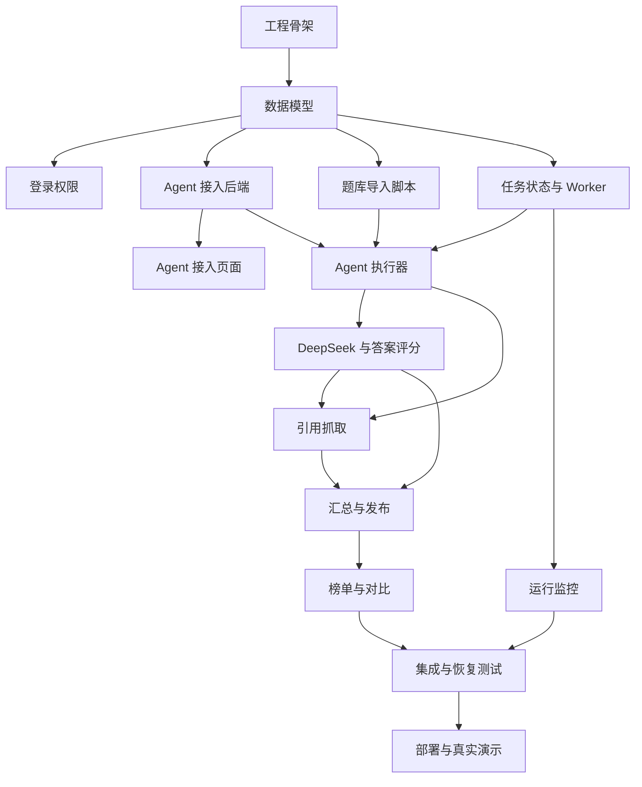

# Agent 评测平台开发任务与四周计划

## 1. 计划信息

| 项目 | 内容 |
|---|---|
| 计划版本 | V0.1 |
| 对应 PRD | `agent-evaluation-platform-prd.md` |
| 对应架构 | `agent-evaluation-platform-architecture.md` |
| 开发资源 | 1 人全栈 |
| 开发周期 | 4 周，20 个工作日 |
| 交付目标 | 可真实运行和演示的端到端 MVP |
| 演示规模 | 2 个第三方 Agent、100 道固定题 |

## 2. 演示 MVP 范围

### 2.1 必须完成

- 单仓库、Docker Compose 和单机部署。
- 只读密码与运营密码登录。
- Agent 基础信息、同步 POST JSON、Bearer Token、`{{prompt}}` 模板和 JSONPath 映射。
- Agent 测试请求和配置版本。
- 通过脚本导入固定 100 题演示题库。
- 单评测任务、SQLite 任务持久化、Worker 租约和心跳。
- 每个 Agent 默认 5 路并发。
- 超时、429、5xx 重试一次。
- 选择题规则评分。
- 短答案 DeepSeek 正误评分。
- 开放题 DeepSeek 1 至 5 分评分。
- 最多 3 个引用抓取、基础 SSRF 防护和引用支撑度评分。
- 固定能力权重：问答 40%、检索 35%、数据与数值推理 25%。
- 任务进度、错误数量和取消任务。
- 最新综合榜、三个能力分和核心指标。
- 两个 Agent 指标表与雷达图对比。
- 服务重启后识别未完成任务并恢复未完成项。
- 大陆网络不可达的引用按 0 分处理并标记原因。

### 2.2 演示版明确不做

- 900 题完整正式题库。
- 5 个 Agent 完整规模运行。
- 题库导入页面。
- 裁判模型和评分权重配置页面。
- 暂停与继续。
- 页面内通知。
- Benchmark、语言、Agent 版本和历史批次的复杂筛选。
- 逐题结果和失败题分析页面。
- 报告导出。
- 自动 30 天清理。
- 自动每日备份和恢复页面。
- 操作审计。
- 移动端。

以上能力保留必要数据结构和扩展接口，但不建设用户界面或完整产品流程。

## 3. 演示题库

100 题保持中文 70%、英文 30%。

| 能力 | Benchmark | 语言 | 题量 |
|---|---|---:|---:|
| 通用问答与推理 | C-Eval | 中文 | 30 |
| 通用问答与推理 | MMLU-Pro | 英文 | 10 |
| 信息检索 | BrowseComp-ZH | 中文 | 20 |
| 信息检索 | BrowseComp | 英文 | 10 |
| 数据与数值推理 | BizFinBench | 中文 | 20 |
| 数据与数值推理 | FinQA | 英文 | 10 |

抽样要求：

- 固定题目，不在运行时随机抽取。
- 保留原始问题，不翻译和改写。
- 固定抽样种子、来源版本和题目哈希。
- BizFinBench 需要包含至少一种短答案和一种开放回答任务，确保演示两类 LLM 评分。
- 演示数据通过后端管理命令导入，不开发导入页面。

## 4. 交付里程碑

| 里程碑 | 时间 | 可验收结果 |
|---|---|---|
| M1 基础接入 | 第 1 周结束 | 可登录、创建 Agent、发送测试请求并保存版本 |
| M2 单题到评分 | 第 2 周结束 | 可执行小题集并完成规则与 DeepSeek 评分 |
| M3 端到端主流程 | 第 3 周结束 | 可完成 2 Agent × 100 题并生成榜单 |
| M4 可演示版本 | 第 4 周结束 | 页面完整、真实 API 联调、部署和演示脚本通过 |

## 5. 工作量总览

| 模块 | 预计人日 |
|---|---:|
| 工程与部署骨架 | 1.0 |
| 数据库与领域模型 | 1.0 |
| 登录与权限 | 1.0 |
| Agent 接入与版本 | 2.0 |
| 演示题库与导入 | 1.0 |
| Worker、任务状态和恢复 | 2.0 |
| Agent 执行与重试 | 1.0 |
| DeepSeek 与评分 | 2.0 |
| 引用抓取与安全 | 2.0 |
| 汇总与自动发布 | 1.0 |
| 运行监控页面 | 1.0 |
| 榜单与横向对比 | 2.0 |
| 集成、安全和恢复测试 | 1.0 |
| 真实评测、修复和演示 | 2.0 |
| 合计 | 20.0 |

该估算没有富余时间。任何新增页面、协议或 Benchmark 都必须替换现有任务，不能直接加入四周范围。

## 6. 任务依赖图

## 7. 详细任务拆分

### T01 工程和部署骨架

| 项目 | 内容 |
|---|---|
| 工期 | 1 人日 |
| 依赖 | 无 |
| 产出 | React、FastAPI、Worker、Nginx、Docker Compose 可启动 |

任务：

- 创建单仓库目录结构。
- 配置 Python、TypeScript、Ruff、mypy、ESLint 和基础测试命令。
- 创建 FastAPI 健康检查。
- 创建 React 路由和基础 CSS 变量。
- 创建 API、Worker、Nginx Dockerfile 和 Compose。
- 创建 SQLite 与 Artifact 数据卷。
- 固定开发和生产环境变量模板，禁止提交真实密钥。

验收：

- 一条命令可启动 Web、API 和 Worker。
- `/health/live` 和 `/health/ready` 正常。
- React 可以调用 API 并展示服务状态。

### T02 数据库与领域模型

| 项目 | 内容 |
|---|---|
| 工期 | 1 人日 |
| 依赖 | T01 |
| 产出 | SQLite Schema、迁移和基础 Repository |

任务：

- 配置 WAL、Foreign Keys、Busy Timeout 和 Synchronous。
- 创建 Agent、Agent Version、Benchmark、Question、Run、Execution Item、Score、Leaderboard、Session 和 Worker Lease 表。
- 创建 Alembic 初始迁移。
- 创建通用时间、ID、状态枚举和事务工具。
- 为 Run、Execution Item 和 Snapshot 建立必要索引和唯一约束。

验收：

- 空数据库可自动迁移到最新版本。
- 约束能够阻止重复题目和重复执行项。
- SQLite 重启后数据保持完整。

### T03 双密码登录与权限

| 项目 | 内容 |
|---|---|
| 工期 | 1 人日 |
| 依赖 | T02 |
| 产出 | 只读和运营 Session、登录页和路由保护 |

任务：

- 使用 Argon2id 校验只读密码和运营密码。
- 创建 Session Token 和 HttpOnly Cookie。
- 实现只读、运营权限依赖。
- 校验 Origin 和基础 CSRF Token。
- 实现登录限速。
- 创建简洁登录页和无权限状态。

验收：

- 只读密码只能访问榜单 API。
- 运营密码可以访问配置和运行 API。
- 未登录和过期 Session 被正确拦截。

### T04 Agent 接入后端

| 项目 | 内容 |
|---|---|
| 工期 | 1 人日 |
| 依赖 | T02 |
| 产出 | Agent CRUD、配置版本、测试请求 API |

任务：

- 实现 Agent 基础信息 CRUD。
- 实现 POST JSON、无鉴权和 Bearer Token 配置。
- 使用 AES-GCM 加密 Token。
- 校验 JSON 请求模板只包含 `{{prompt}}`。
- 校验答案和引用 JSONPath。
- 实现测试请求，返回脱敏请求、原始响应摘要、答案和引用。
- 修改配置时创建新版本。

验收：

- 可接入两个不同 JSON 格式的 Fake Agent。
- Token 不在 API 响应和日志中明文出现。
- 模板或 JSONPath 非法时拒绝保存。

### T05 Agent 接入页面

| 项目 | 内容 |
|---|---|
| 工期 | 1 人日 |
| 依赖 | T03、T04 |
| 产出 | Agent 列表、编辑表单和测试结果页面 |

任务：

- 实现项目内 Button、Input、Textarea、Select、FormField、Table 和 Modal。
- 实现 Agent 列表和状态。
- 实现多步骤配置表单。
- 实现测试问题、测试状态和响应提取预览。
- 实现保存版本和错误提示。

验收：

- 运营可以不修改代码完成 Agent 配置和测试。
- 页面不回显完整 Token。
- 配置错误能够定位到具体字段。

### T06 演示题库与导入命令

| 项目 | 内容 |
|---|---|
| 工期 | 1 人日 |
| 依赖 | T02 |
| 产出 | 100 题标准数据和幂等导入命令 |

任务：

- 定义统一 Question Schema。
- 编写六个 Benchmark 的最小转换器或离线转换脚本。
- 按 70/30 比例固定抽样 100 题。
- 生成数据版本、题目哈希和来源元数据。
- 实现幂等 CLI 导入命令。
- 添加题量、语言和题型分布校验。

验收：

- 重复运行导入命令不会生成重复题目。
- 系统严格显示 100 题、中文 70 题、英文 30 题。
- 三个能力和三种评分题型均有样本。

### T07 SQLite 任务状态与 Worker

| 项目 | 内容 |
|---|---|
| 工期 | 2 人日 |
| 依赖 | T02 |
| 产出 | 可持久化的单任务队列、租约、心跳和取消状态机 |

任务：

- 实现 Run 创建和 Execution Item 批量初始化。
- 实现 Worker 单例租约和续租。
- 实现 Run 状态机和阶段迁移。
- 实现 Worker 心跳。
- 实现进程内 Result Writer 单写入队列。
- 实现取消目标状态。
- 实现启动恢复和 Abandoned Attempt 处理。
- 实现任务进度聚合字段。

验收：

- 同时只能执行一个 Run。
- 第二个 Run 保持排队。
- Worker 重启后不重复已完成 Execution Item。
- 取消后不再创建新的 Agent 请求。

### T08 Agent 执行器

| 项目 | 内容 |
|---|---|
| 工期 | 1 人日 |
| 依赖 | T04、T06、T07 |
| 产出 | Prompt、并发请求、重试、响应解析和 Artifact |

任务：

- 根据题型生成最终 Prompt。
- 将 Prompt 安全注入 JSON 模板。
- 为每个 Agent 创建默认 5 路并发限制。
- 实现 120 秒超时。
- 实现 429、5xx、超时重试一次。
- 实现 JSON 和 JSONPath 解析。
- 保存原始响应 Artifact、答案预览和哈希。
- 统计全部 HTTP Attempt。

验收：

- Fake Agent 的正常、超时、429、5xx、非法 JSON 和空答案场景符合 PRD。
- 每次实际 HTTP 尝试均进入调用次数。
- 原始响应未直接写入 SQLite 大字段。

### T09 DeepSeek 与答案评分

| 项目 | 内容 |
|---|---|
| 工期 | 2 人日 |
| 依赖 | T06、T08 |
| 产出 | 固定 DeepSeek 客户端和三类答案评分 |

任务：

- 实现 DeepSeek `deepseek-chat` 客户端。
- 实现短答案正误 Schema 和 Prompt。
- 实现开放题 1 至 5 分 Schema 和 Prompt。
- 实现结构化输出校验和格式失败重试一次。
- 实现选择题选项提取和规则评分。
- 保存简短理由和裁判 Artifact。
- 实现评分纯函数单元测试。

验收：

- 选择题只输出 0 或 100。
- 短答案只输出 0 或 100。
- 开放题正确映射为 0、25、50、75、100。
- 裁判连续返回非法结构时 Run 进入系统失败，不发布榜单。

### T10 引用抓取与评分

| 项目 | 内容 |
|---|---|
| 工期 | 2 人日 |
| 依赖 | T08、T09 |
| 产出 | 安全抓取器、正文抽取、真实性和支撑度评分 |

任务：

- 实现 HTTP(S) URL 解析和去重，保留前 3 个。
- 拒绝回环、内网、链路本地、保留地址和云元数据地址。
- 实现 DNS 校验和重定向逐跳校验。
- 限制超时、重定向、响应体和正文大小。
- 使用 trafilatura 提取纯文本。
- 实现 DeepSeek 引用支撑度评分。
- 实现答案 70%、引用 30% 计算。
- 标记不可达、禁止和不支持内容。

验收：

- 内网和云元数据 URL 无法访问。
- 非法和抓取失败引用按 0 分参与平均。
- 每题最多产生 3 个 Citation Record。
- 英文境外链接不可达时明确标记原因，不误标为系统失败。

### T11 汇总、榜单与自动发布后端

| 项目 | 内容 |
|---|---|
| 工期 | 1 人日 |
| 依赖 | T09、T10 |
| 产出 | Benchmark、能力、综合分、快照和查询 API |

任务：

- 实现单题、Benchmark、能力和综合分纯函数。
- 固定综合权重 40/35/25。
- 实现中文分、英文分、答案指标、引用指标、成功率、异常率和调用次数。
- 实现自动发布条件检查。
- 实现事务化榜单快照发布。
- 实现最新榜单和两个 Agent 对比 API。

验收：

- 汇总公式与 PRD 测试样例一致。
- Agent 失败题记 0 但不阻止发布。
- 裁判或存储系统异常阻止发布并保留旧榜。
- 调用次数不影响综合分和排名。

### T12 评测向导与运行监控

| 项目 | 内容 |
|---|---|
| 工期 | 1 人日 |
| 依赖 | T03、T05、T07、T08 |
| 产出 | 发起评测、进度轮询和取消页面 |

任务：

- 实现选择两个 Agent 的简化评测向导。
- 固定选择演示题库、DeepSeek 和 40/35/25 权重。
- 展示题量和预计首次调用次数。
- 实现任务列表和运行详情。
- 每 3 秒轮询进度，不可见页面降低频率。
- 展示各 Agent 完成、失败和重试数量。
- 实现取消确认和终态页面。

验收：

- 运营可从页面发起 2 Agent × 100 题评测。
- 页面刷新不丢失任务状态。
- 取消后页面和后端状态一致。

### T13 排行榜与横向对比页面

| 项目 | 内容 |
|---|---|
| 工期 | 2 人日 |
| 依赖 | T03、T11 |
| 产出 | 默认首页、综合榜、能力指标和雷达图 |

任务：

- 实现最新综合榜默认首页。
- 展示排名、综合分、三个能力分、答案和引用指标、调用次数、成功率和异常率。
- 实现综合榜与三个能力字段切换。
- 实现两个 Agent 指标表。
- 使用 ECharts 实现固定 0 至 100 的能力雷达图。
- 实现加载、空数据、旧榜保留和发布失败状态。

验收：

- 只读密码登录后直接进入榜单。
- 榜单数据与后端快照一致。
- 两个 Agent 可在同一批次中对比。
- 调用次数只展示，不参与雷达图和排名。

### T14 集成、安全和恢复测试

| 项目 | 内容 |
|---|---|
| 工期 | 1 人日 |
| 依赖 | T03 至 T13 |
| 产出 | 完整 Fake 场景、关键自动化测试和修复清单 |

任务：

- 扩展前序任务中已使用的 Fake Agent 和 Fake Judge 场景。
- 覆盖登录权限、重试、取消、裁判失败和发布回滚。
- 覆盖 SSRF 关键地址和重定向。
- 覆盖 Worker 重启恢复。
- 检查日志中无 Token、Cookie、完整 Prompt 和原始响应。
- 修复高严重级问题。

验收：

- 核心后端集成测试通过。
- 运营和只读权限隔离通过。
- Worker 重启不重复已完成题目。
- SSRF 基础用例全部通过。

### T15 部署、真实评测和演示准备

| 项目 | 内容 |
|---|---|
| 工期 | 2 人日 |
| 依赖 | T14 |
| 产出 | 大陆云主机部署、真实运行报告和演示脚本 |

任务：

- 配置云安全组、IP 白名单、TLS 和生产 Secret。
- 部署 Docker Compose。
- 执行 2 Agent × 20 题冒烟测试。
- 执行 2 Agent × 100 题完整测试。
- 记录耗时、失败率、DeepSeek 调用量、引用不可达比例和磁盘增长。
- 修复阻断问题。
- 准备 10 分钟演示脚本和备用已发布榜单。
- 编写启动、停止、查看日志和手动 SQLite 备份命令说明。

验收：

- 白名单外无法访问平台。
- 两个真实 Agent 可完成 100 题并自动发布。
- 演示过程中可展示接入、运行、榜单和对比完整路径。
- 即使第三方 API 临时不可用，也能使用备用榜单完成结果演示。

## 8. 四周逐日计划

### 第 1 周：基础接入

| 日期 | 任务 | 当日结果 |
|---|---|---|
| Day 1 | T01 | 工程和 Compose 可启动 |
| Day 2 | T02 | Schema 和迁移完成 |
| Day 3 | T03 | 双密码登录完成 |
| Day 4 | T04 | Agent 接入 API 完成 |
| Day 5 | T05 | Agent 接入页面可用，M1 验收 |

### 第 2 周：执行与答案评分

| 日期 | 任务 | 当日结果 |
|---|---|---|
| Day 6 | T06 | 100 题可重复导入 |
| Day 7 | T07 | Worker 队列和租约 |
| Day 8 | T07 | 心跳、取消和恢复 |
| Day 9 | T08 | Agent 并发与重试 |
| Day 10 | T09 | 规则和 DeepSeek 答案评分第一部分 |

第 2 周结束时以选择题评分、DeepSeek 客户端和短答案评分链路作为 M2 验收；开放题和异常结构处理在 Day 11 完成。

### 第 3 周：引用、榜单与运行页面

| 日期 | 任务 | 当日结果 |
|---|---|---|
| Day 11 | T09 | 开放题、异常结构处理和裁判测试 |
| Day 12 | T10 | URL 安全、SSRF 和抓取框架 |
| Day 13 | T10 | 正文提取与引用评分 |
| Day 14 | T11 | 汇总和自动发布 |
| Day 15 | T12 | 评测向导与运行监控，M3 验收 |

### 第 4 周：对比、加固与真实演示

| 日期 | 任务 | 当日结果 |
|---|---|---|
| Day 16 | T13 | 最新榜单和能力指标 |
| Day 17 | T13 | 指标对比和雷达图 |
| Day 18 | T14 | 集成、安全和恢复测试 |
| Day 19 | T15 | 云主机部署和 20 题冒烟 |
| Day 20 | T15 | 100 题真实评测、阻断修复和 M4 验收 |

## 9. 每周验收门槛

### 第 1 周

- 不接受只完成静态页面。
- 必须真实调用 Fake Agent 并提取答案和引用。
- Token 必须已加密保存和脱敏。

### 第 2 周

- 不接受仅使用进程内任务状态。
- Run 和 Execution Item 必须写入 SQLite。
- Worker 重启后必须识别已完成项。
- 至少完成选择题和短答案评分。

### 第 3 周

- 不接受 Mock 榜单。
- 榜单必须由真实执行和评分结果汇总产生。
- 引用抓取必须包含 SSRF 基础防护。
- 自动发布必须使用事务并保留旧榜。

### 第 4 周

- 必须在目标大陆云主机完成真实运行。
- 必须记录英文引用不可达对检索分的影响。
- 必须有已发布备用榜单，避免演示依赖第三方实时稳定性。

## 10. 完成定义

每个任务只有同时满足以下条件才算完成：

- 代码已实现并通过静态检查。
- 核心逻辑有自动化测试。
- 错误状态可见且不会泄露敏感信息。
- 数据状态可在刷新或重启后保持。
- API Schema 和前端使用一致。
- 文档中的启动或验证步骤可重复执行。
- 没有阻断后续关键路径的临时假实现。

## 11. 演示验收脚本

1. 使用运营密码登录。
2. 展示两个不同 API 格式的 Agent。
3. 修改一个 Agent 配置并创建新版本。
4. 发送测试问题，展示提取的答案和 URL 数组。
5. 发起 2 Agent × 100 题评测。
6. 展示任务进度、重试和错误数量。
7. 使用预先完成的批次展示自动发布结果。
8. 使用只读密码重新登录并进入最新综合榜。
9. 展示三个能力分、答案指标、引用指标、调用次数和异常率。
10. 选择两个 Agent，展示指标表和雷达图。
11. 说明英文引用因大陆网络不可达被记 0 的已知限制。

## 12. 风险与应对

### 12.1 一人开发没有并行余量

任何单项延期都会影响后续关键路径。每天结束时更新剩余工时，超过 1 天的偏差立即削减非关键样式和辅助页面，不削减安全边界与数据正确性。

### 12.2 六个 Benchmark 适配可能超时

优先将数据离线转换成统一 JSONL。平台只实现一个标准导入器，不在运行时依赖各 Benchmark 官方 SDK。若 Day 6 未完成，先保证每个能力至少一个中文和一个英文来源，不增加总题量。

### 12.3 不使用 UI 组件库

只实现 10 个以内基础组件，不做复杂主题、拖拽、虚拟表格和移动端。不为演示重写已有可用组件。

### 12.4 引用抓取安全复杂

SSRF 防护不可省略。正文抽取效果不佳时允许将引用记为不支持，但不能为了提高抓取率放宽内网地址、重定向和响应体限制。

### 12.5 DeepSeek 或 Agent 不稳定

Fake 服务必须在第 2 周完成。第 4 周提前生成一个真实已发布批次，现场演示不等待完整 100 题实时运行。

### 12.6 SQLite 写锁

保持单 API 进程、单 Worker 和单 Result Writer。出现锁问题时先缩短事务和调整批量写入，不增加 Worker 数量。

## 13. 演示后待办

按建议顺序补齐完整 P0：

1. 900 题完整题库和 5 Agent 规模测试。
2. 题库导入与版本管理页面。
3. 裁判模型与能力权重配置页面。
4. 暂停和继续。
5. 历史批次、语言、Benchmark 和 Agent 版本筛选。
6. 页面内通知。
7. 30 天 Artifact 自动清理。
8. 每日备份、恢复验证和异机备份。
9. 逐题结果与失败题分析。
10. 操作审计和个人账号体系。

## 14. 结论

当前完整 PRD 不适合 1 人在 4 周内全部实现。演示 MVP 将范围缩减为 2 个 Agent、100 道固定题和端到端评测主流程，同时保留任务持久化、SSRF 防护、评分正确性和原子发布等不能妥协的工程质量。

按照本计划执行，第 3 周应得到可以真实生成榜单的版本，第 4 周用于横向对比、目标云部署、真实 API 联调和演示稳定性，而不是继续增加功能。
